<h1 align="center">chaierww</h1>

<p align="center">
  <b>One person. Eight accounts. One control center.</b><br>
  <sub>Multi-account manager for WorkBuddy (China) and Trae (China): 1-second switching, automatic renewal, one-click daily activities. Everything stays on your machine — switching works offline.</sub>
</p>

<p align="center">
  
  
  
</p>

<p align="center">
  <a href="https://github.com/Chaierss/workbuddy-trae-assist/releases/latest"><b>Download latest</b></a> ·
  <a href="docs/QUICKSTART.en.md">3-minute quick start</a> ·
  <a href="README.md">简体中文</a> ·
  <a href="#interface">Interface</a> ·
  <a href="#features">Features</a> ·
  <a href="#faq">FAQ</a> ·
  <a href="#development">Development</a>
</p>

<p align="center">
  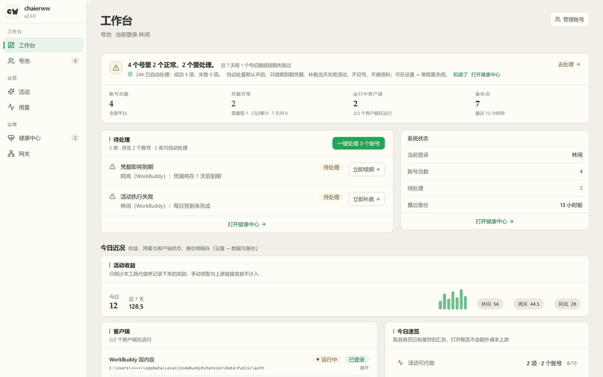
</p>

<p align="center">
  <b>Windows</b>: download <code>chaierww-Setup-&lt;version&gt;.exe</code>, double-click to install, no admin rights　·　
  <b>Linux x64</b>: download <code>chaierww-x86_64.AppImage</code>, <code>chmod +x</code>, then run
</p>

## What this is

A multi-account manager that runs on your own computer. It gathers your WorkBuddy (China) and Trae (China) accounts in one place:

- **Switching**: from 60 seconds of "log out → scan → wait for sync → find your session" to a one-second click;
- **Renewal**: renews ahead of token expiry, backs off on failure and trips a breaker after consecutive failures — no more manual re-login;
- **Activities**: check-ins, growth tasks and streak milestones listed per account with progress; whatever can run automatically does, manual items say exactly how to do them;
- **Gateway**: lends the pool's quota to other local AI tools through OpenAI / Anthropic-compatible endpoints.

**Who it is for**: people maintaining 2 or more accounts and moving between them every day.
**Who it is not for**: people with a single account; people who want cloud hosting, account sharing or login on their behalf — it does none of that.

**All data stays on your own machine**: no cloud relay, no account hosting, and switching works with the network unplugged.

> Unofficial third-party tool, not affiliated with, authorized by, or endorsed by WorkBuddy / Trae or their rights holders.
> It reads and writes local client auth data and makes requests automatically according to your configuration. Read the
> **[disclaimer](docs/policies/DISCLAIMER.md)** before use.

## Why install it

Switch accounts five times a day and that is 1,800 switches a year. At sixty seconds each it adds up to thirty
hours — **four working days** — all spent on "just a moment". And not one of those times was something you wanted to do.

<p align="center">
  <b>1,800 / year</b>　·　<b>60s → 1s</b>　·　<b>0 servers</b>　·　<b>7 backups</b>　·　<b>1 shortcut</b>
</p>

|  | By hand | chaierww |
|:--|:--|:--|
| One switch | log out → scan → wait for sync → find your session, ~60s | one click, **1 second** |
| Failure handling | broken state, and you debug it yourself | automatic rollback to the pre-switch snapshot |
| Before touching anything | write first, find out when it breaks | read-only preview showing which files would change |
| Multi-account rotation | remember whose credits expire first | picks the account by expiry time |
| Organizing accounts | notes and memory | group tags, filter and bulk-assign by group |
| Backups | none | one automatic copy per day, last 7 kept |

## A day

The same features, translated into your day — these are the actions it saves:

| Time | What you do | What it saves you |
| :-- | :-- | :-- |
| 09:00 | One click to your main account | logging out, scanning, waiting for sync, finding the session |
| 13:30 | Type two letters in `Ctrl+K`, switch to the backup | hunting through the pool, matching accounts, tracking whose credits expire first |
| 18:00 | Run today's activities in one click | opening each activity, ticking each step, finding the manual entries |
| 02:00 | Nothing | the patrol renews credentials; failures back off at 1 hour / 6 hours, breaker after three failures |

Every item above can be turned off or rescheduled in the app. Nothing is decided for you.

## Features

Grouped by the four things you actually use, keeping only the hardest bullets in each.

### Switching: 60 seconds → 1 second

- **One click to switch**: start from an account card, the `Ctrl+K` command palette (typing searches accounts, and it
  understands pinyin and English aliases) or the desktop tray — all through the same read-only preflight, with automatic
  rollback to the pre-switch snapshot on failure
- **One keystroke away**: on desktop, `Ctrl+Alt+1..8` maps to the 8 most recently used accounts, and it works even when
  the window is hidden in the tray
- **Undo a switch**: after a successful switch the dialog offers "switch back to the previous account", which runs the
  preflight again instead of bypassing confirmation
- **Look before you leap**: a read-only preview before switching lists every file that would change; not a byte is written
- **Relaunch under your control**: whether the client restarts after a switch can be turned off under Settings → Accounts & switching

### Account pool: stop tracking whose token expires first

- **Credentials renew themselves**: dynamic early renewal based on token lifetime (minimum 30 minutes, maximum 6 hours);
  failures back off at 1 hour / 6 hours, consecutive failures trip a breaker, and after a trip you can resume auto-renewal
  in one click
- **One line tells you whether to care**: the top of the Workbench gives a verdict (all good / an account needs attention /
  health events remain) and also flags accounts that failed a switch or renewal in the last 7 days — click the right side
  to jump to that page
- **One number, one definition**: the pool, the health center and the supply figures read the same
  credential checkup, so only accounts with real gaps count as pending; accounts excluded or isolated by the
  gateway are counted separately as "N excluded", and healthy + cooling + excluded adds up to the total
- **What needs handling surfaces on its own**: the Workbench "needs attention" area shows only the top 3 groups, with
  one-click renew / rerun and an immediate "done / needs manual" verdict; the policy itself still lives only in
  Settings → Automation
- **One-click pool checkup**: login recheck, credential liveness, supply and isolation in one pass, with a next step per
  finding (re-login / renew / diagnose / release isolation / open the health center) — no scoring or recommendations
- **Diagnose before guessing**: a six-step read-only diagnosis (credential readable, renewable, device is this machine,
  remaining lifetime, backoff/breaker, read-only liveness) with a verdict and advice for each step; it writes no data and
  rotates no tokens
- **Groups and a recycle bin**: free-form tags with group filtering and bulk group assignment; deletions go to a 30-day
  recycle bin and can be restored

### Activities: today's work in one click

- **The official catalog ships with each version**: check-in, growth tasks, streak milestones, cat travel, night owl,
  back-to-school — each with its rules and rewards spelled out; activities outside the catalog are marked "not covered"
  and sink to the bottom instead of silently disappearing
- **Progress per account**: how far each account got, which item it is stuck on and which items can run automatically, on
  one screen; items that cannot run explain "how to" by family, and a manual step can be verified on the spot with
  "re-check"
- **Visible returns**: today / last 7 days totals, a mini trend and the top 3 accounts; it counts only rewards this tool
  performed and recorded — manual claims are not counted
- **Run today's work in one click**: renewals that are due plus every automatable activity across all accounts in one go,
  with a "done / needs manual" receipt

### Gateway: lend your quota to other local AI tools

- **Compatible endpoints**: exposed as OpenAI / Anthropic-compatible endpoints; keys can be issued and revoked, with
  per-key daily token / request caps and per-minute limits
- **Strategy-driven account selection**: `balanced` / `quality` / `quota` / `smart`, with a minimum-credit threshold and a
  per-account concurrency cap; when everything is saturated it returns `503` + `Retry-After: 1` right away
- **It keeps the books and warns early**: a 90-day daily ledger with separate credit snapshots; "usage forecast" gives a
  14-day trend, each account's projected exhaustion date and each key's daily budget progress; when the data is too thin
  it honestly shows `insufficient`

<details>
<summary>Everything else (scheduled tasks, backups, sessions, onboarding, experience data)</summary>

- **The title bar is the menu**: Edit / View / Help all label each action with its shortcut (undo `Ctrl+Z`, fullscreen
  `F11`, zoom `Ctrl+= / - / 0`, devtools `Ctrl+Shift+I`), and `Alt+F/E/V/H` opens them; the search button opens the same
  command palette as `Ctrl+K`, which understands pinyin and English aliases (`hc` finds the pool, `sz` finds settings)
- **If it cannot read, it says so**: a failed backup read shows "unavailable" with a retry; loading shows a skeleton, never
  a fake `0` or empty state
- **Patrol history**: each account keeps its last 20 patrol records — time, status, reason and next retry — and they
  survive restarts; "resume" only clears the counter, it does not delete the history
- **Deleted by mistake?**: the recycle bin keeps accounts for 30 days, can restore them, purge early or empty in one click
- **Run history in one place**: the task center splits into "this run's receipt / run history"; every run keeps its verdict
  and reason, and the details include a 14-day success / skip / failure bar trend
- **Usage** is aggregated by model and by day, so you can see who is burning quota at a glance
- **The gateway keeps the books**: every request leaves a per-hop account trail you can expand in the log; 429s honor the
  upstream `Retry-After` (capped at 30 minutes); the pool spells out why each account is excluded and for how long, and
  accounts excluded by upstream rate limits or errors come back automatically when the time is up
- **Forecasts only count complete days**: an average needs at least 2 days with requests, and no exhaustion date is
  guessed when the balance has not actually dropped
- **Scheduled tasks**: several times a day with random jitter, scoped to chosen accounts and activities, keeping only the
  last 7 runs per slot — successes and failures both carry a reason, and per-account counts can be expanded
- **Desktop notifications**: when accounts need a re-login, the tray shows "N accounts need re-login" and sends one system
  notification — at most once per account per day — linking straight to credential health
- **Backups travel back in time**: snapshots can be verified and any one of them restored; restore applies before the
  database opens on the next launch, and rolls back automatically on failure
- **Sessions follow the account**: chat sessions and web-login state are mirrored between accounts on the same machine, so
  you can keep chatting after a switch; bodies are content-hashed and stored once, appends follow the source, deletions
  follow too, and conflicts stay local for you to resolve one by one; platforms without a local session store (Trae) are
  explicitly marked "unsupported" and sessions never cross machines
- **Self-rescue when something breaks**: Settings → Client & environment offers a health panel and "export diagnostic
  bundle" containing only versions, counts and redacted logs
- **No getting lost on a fresh install**: a five-step checklist on first launch (install the client → scan to add an
  account → first switch → keep it → run activities daily), skippable and collapsible; existing users with accounts are
  treated as already done
- **Local experience data**: anonymous counters such as first-switch success rate and TTFV are written to this machine
  only, and can be disabled, exported or cleared under Settings → Client & environment → Experience data
  ([details](docs/policies/TELEMETRY.md)) — never uploaded

</details>

## Interface

<p align="center">
  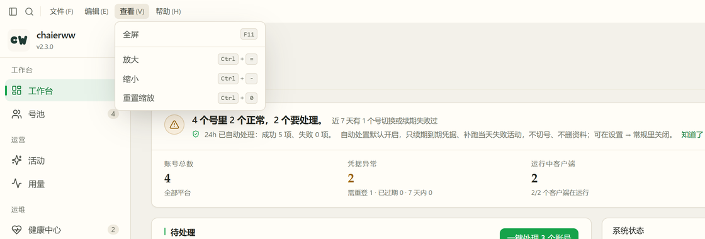
</p>

<p align="center">
  <sub>Desktop title bar: collapse, search, and the File / Edit / View / Help menus — every action carries its shortcut, and Alt+F/E/V/H opens them too</sub>
</p>

| Account pool · accounts, groups, credits and credential status in one view | Usage · requests + credits, by model and by day |
| --- | --- |
| 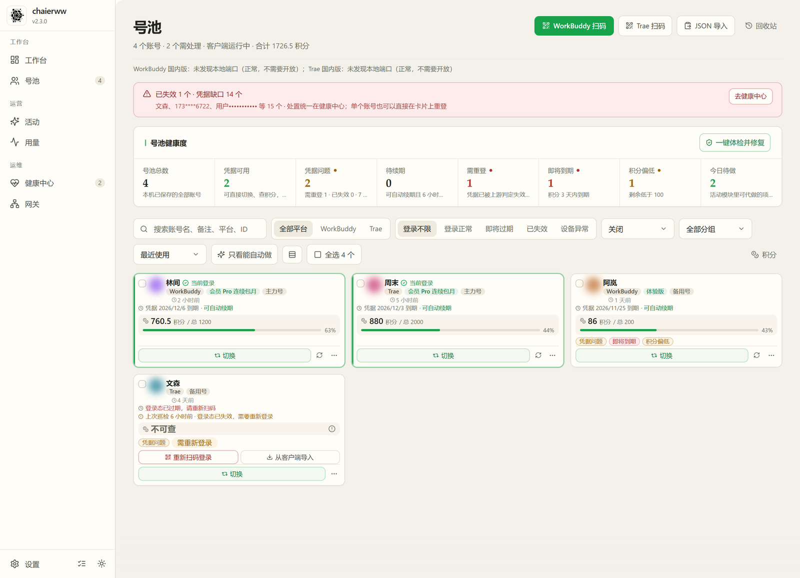 | 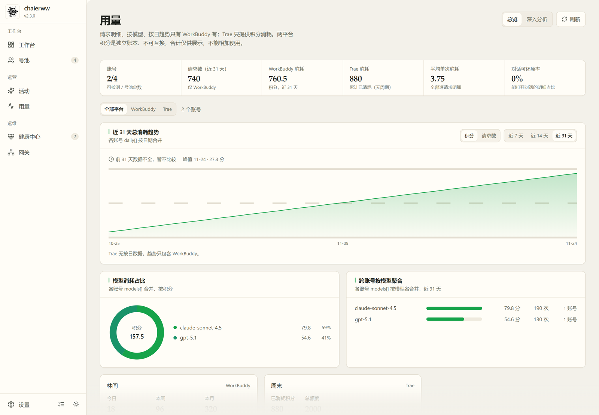 |

| Activity catalog · what exists on the platform, with rules and rewards | By-account tasks · how far each account got, with manual steps explained |
| --- | --- |
| 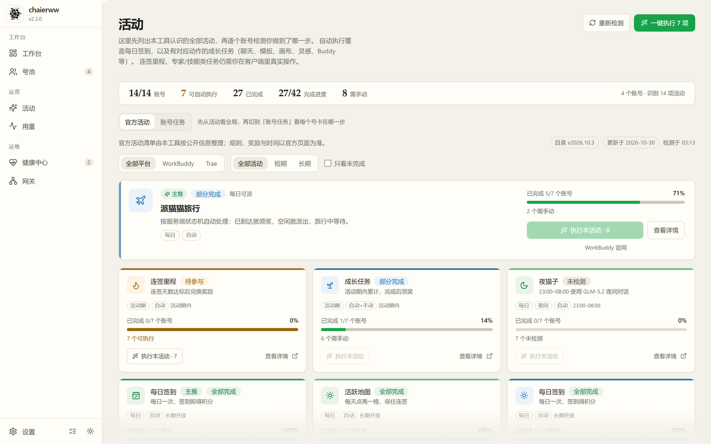 | 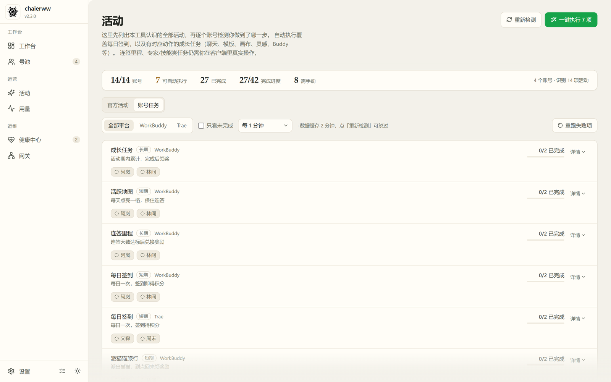 |

<details>
<summary>More screenshots (gateway, keys, scheduled tasks, backup, environment, health center, appearance)</summary>

| Gateway · quota exposed as OpenAI / Anthropic-compatible endpoints | Model catalog · available models and capability notes |
| --- | --- |
| 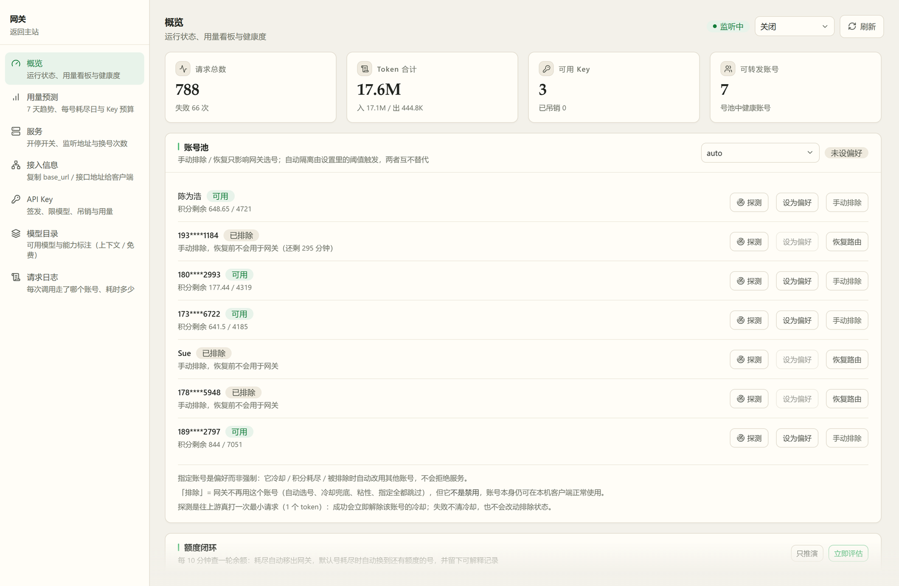 | 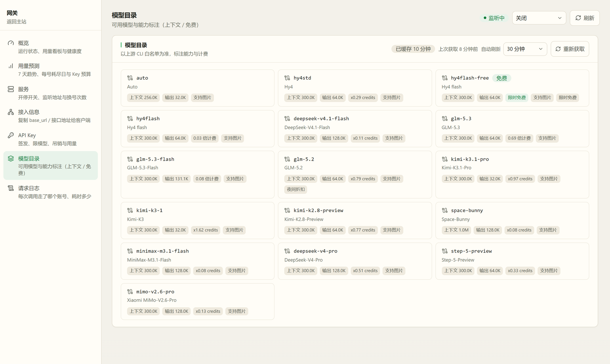 |

| Gateway keys · issue, restrict models, cap budget, revoke anytime | Scheduled tasks · several times a day, last 7 runs kept per slot |
| --- | --- |
| 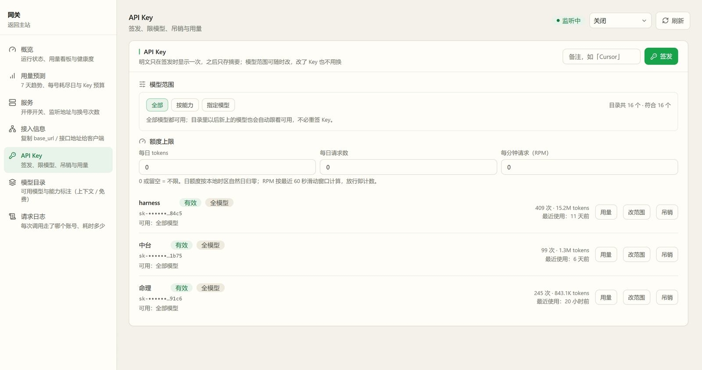 | 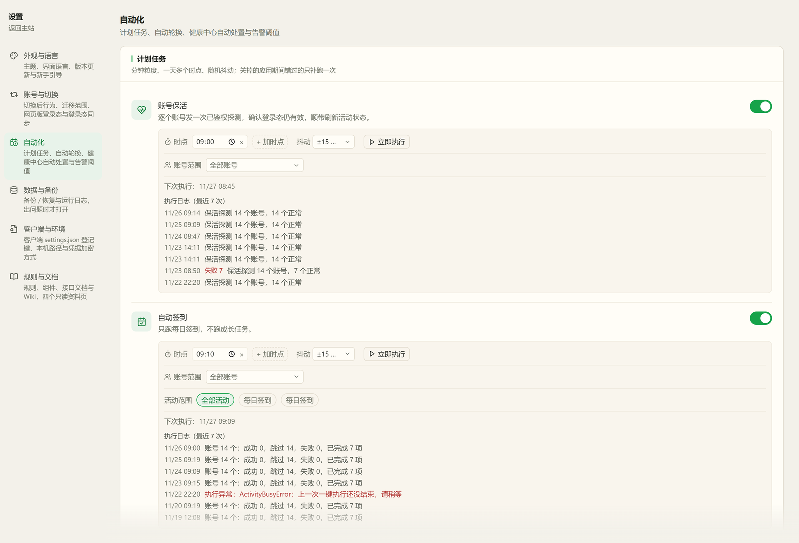 |

| Backup · one automatic copy per day, verifiable, restorable to any one | Environment · local paths, client status and diagnostic bundle |
| --- | --- |
| 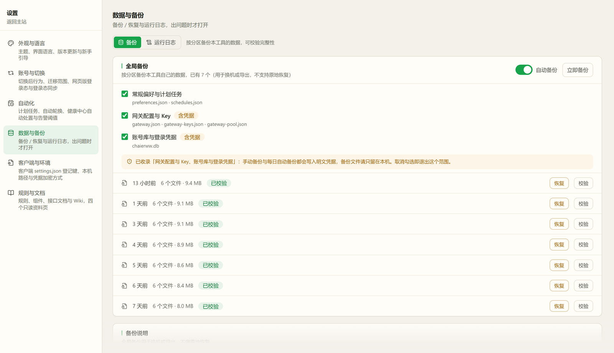 | 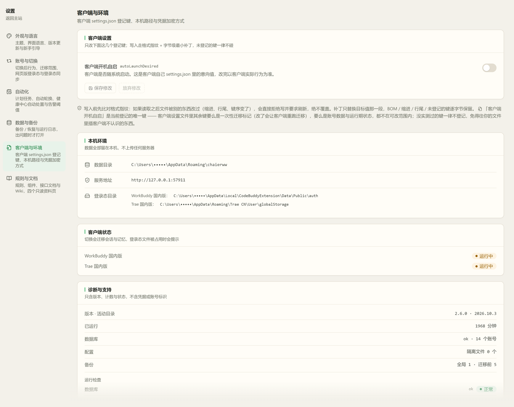 |

| Health center · an event stream for upstream schema, sign-in, supply and activity anomalies | Appearance & language · theme, language, updates and onboarding |
| --- | --- |
| 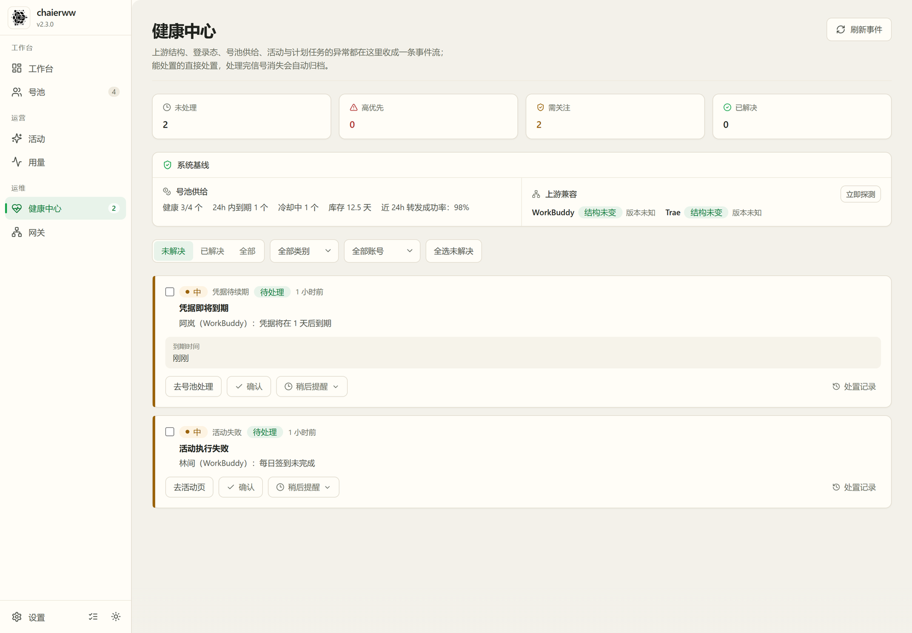 | 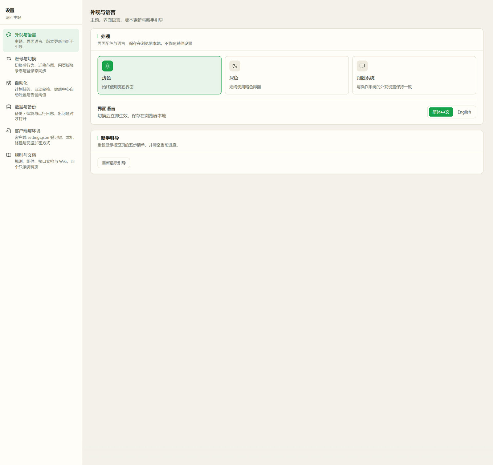 |

</details>

> Screenshots are captured after the script renders the DOM: account names, account IDs, emails, local paths, gateway
> keys and IPs are already replaced with dots or blur inside the page before the shutter fires — not painted over by
> coordinates afterwards, so a redesign does not mean re-measuring positions. The data shown is anonymized demo data,
> produced by `python scripts/shots.py --demo`; the title-bar strip comes from `python scripts/shots.py --titlebar`,
> which injects a desktop-shell stub into the page while still rendering the real frontend.

## Security & boundaries

- Credentials are encrypted at rest and keys never touch a file: DPAPI on Windows (bound to the current user),
  AES-256-GCM on Linux (derived from machine-id + uid, not root-proof); logs are always redacted
- The local API has a same-origin guard by default: same-origin browser cookies pass, external scripts use
  `~/.chaierww/api-token`, and any non-loopback `Host` / `Origin` is rejected ([details](docs/README.md))
- Config and database writes are atomic: temp file + fsync + rename, and corrupt JSON is quarantined with evidence
  instead of silently overwritten
- All data lives in `~/.chaierww` (override with `CHAIERWW_HOME`); copying that directory migrates the whole install
- There is no server. Unplug the network and switching still works

Details and the threat model are in **[SECURITY.md](SECURITY.md)**.

First, what it deliberately does **not** do:

| Not done | Why |
|:--|:--|
| Cloud relay, account hosting, account sharing | that would turn a tool into a service |
| Logging in on your behalf (collecting your password) | too much credential responsibility, and unnecessary |
| Modifying the client binary itself | it only reads and writes state files, it does not patch |
| Uploading any data to a server | data stays local: even statistics are local anonymous counts, never uploaded, no third-party SDK |
| Bypassing platform quotas or risk controls | it manages your own accounts, it does not farm them |

Then the things it **cannot** do — these are hard limits, not a schedule:

| Not possible | Notes |
| :-- | :-- |
| Moving accounts between machines | Trae tokens are bound to the issuing device; an account exported elsewhere is rejected upstream (`20403`) and must be scanned or imported again on this machine |
| Doing activities through the web version | there is no web-login path; activities only use local requests equivalent to the client's |
| Fully automating every growth task | 10 of them mark a task complete through an API call rather than actually performing it; they are excluded from scheduled tasks by default, and a manual run shows a notice first |
| macOS | not ported, not shipped; `default_box()` raises `PlatformNotSupported` |
| Running the installer on CentOS 7 | artifacts link against glibc 2.31+; on 2.17 you get `GLIBC_2.28 not found`, so only the backend can run from source |

## Install

Download the latest build from [Releases](https://github.com/Chaierss/workbuddy-trae-assist/releases).

- **Windows**: `chaierww-Setup-<version>.exe`, double-click to install. It installs for the current user only, needs no
  admin rights and goes into your user directory; the wizard first shows the license highlights and the disclaimer.
- **Linux x64**: `chaierww-x86_64.AppImage` (`chmod +x` then run, add `APPIMAGE_EXTRACT_AND_RUN=1` if FUSE is missing) or
  `chaierww-amd64.deb` (`sudo apt install ./….deb`). **CentOS 7 with glibc 2.17 will not run** — see
  [boundaries](#security--boundaries).

Open it, scan a QR code to add accounts, and from then on switching is one click.

The installer has no code signature, so Windows blocks it once on first run: choose "More info → Run anyway". That is the
cost of not buying a certificate, not a sign of a bad package.

**Upgrades take care of themselves.** The app checks for and downloads updates silently at startup; only once the download
finishes does it show a note in the sidebar, the tray and Settings → Appearance & language, without interrupting what you
are doing. "Restart and install" applies it immediately, while "Later" installs it the next time you quit. To stop the
automatic check, turn it off under Settings → Appearance & language, where manual checks also live. If you do not want a
particular version, choose "skip this version" in the prompt.

### Platforms

| Platform | Artifact | Notes |
| :-- | :-- | :-- |
| Windows 10 / 11 (x64) | `chaierww-Setup-<version>.exe` | fully supported |
| Linux x64 (Ubuntu 20.04+ / Debian 11+ / CentOS 8+) | AppImage, deb | fully supported, except CentOS 7 |
| macOS | — | not ported, not shipped |

Linux and Windows differ in exactly three places: credential encryption (Windows DPAPI / Linux AES-256-GCM, with the key
derived from `/etc/machine-id` + uid and never written to disk), the login-state directory (`APPDATA` ↔ `XDG_CONFIG_HOME`),
and the client process name (no `.exe`). Linux AES **protects against ciphertext copied to another machine but not against
local root** — see [SECURITY.md](SECURITY.md).

**CentOS 7 users**: the packaged build will not run. Either `pip install -e .` and run
`python -m chaierww.main` on the machine, then open `http://127.0.0.1:57910` in a browser, or build it
yourself on that machine (PyInstaller cannot cross-compile). Full steps are in [docs/LINUX.md](docs/LINUX.md).

macOS is not ported: the backend has no Keychain implementation. The Electron shell, tray and build
scripts are cross-platform though, so PRs are welcome — see the [Development](#development) section.

## Credentials

Every credential in the pool comes from one of two sources, and both renew automatically over the long term:

- **Scan login**: stores `accessToken` / `refreshToken` together with the device private key generated by that login;
- **Import from the client**: stores the client's login-state envelope, with the device private key encrypted alongside it.

Since October 2026, Trae requires a device signature (`DeviceProof`) on renewal requests, and a token is only honored by
the device that issued it. So:

- accounts signed in or imported here renew automatically on this machine for the long term;
- accounts exported from **another machine** are rejected upstream (`20403`, device mismatch), and the card says "bound to
  another device" — scan or import again on this machine;
- when the upstream clearly refuses (`20101` / `20403` and similar), the app stops pretending the account is usable and
  downgrades it to "needs re-login".

Trae is in the middle of merging accounts: the login envelope now carries `uidFusionInfo` (businessUid / oldUid /
newUid), while the uid in the token is still the old one. The app recognizes any of those uids, keeps the pool entry's
identifier as it was at import time, and never mixes up the target account during a switch precheck.

**Patrol cadence**: 08:00 / 20:00 daily (can be disabled). Before each patrol it pulls the login state of "the account the
client is currently signed in with" back into the pool, so the client's own refreshToken rotation cannot invalidate the
pool's copy. The upstream is only contacted once a credential enters its renewal window, computed from token lifetime:

```text
window = min(6h, lifetime × 10%), floor 30 minutes
```

Failures are not retried immediately: wait 1 hour after the first failure, 6 hours after the second, and after three
consecutive auth failures the breaker trips until you sign in again. The card shows the last patrol, last renewal, failure
reason and next retry, with two repair buttons right there: "scan again" and "import from client". After a breaker trip,
"resume auto-renew" only clears the failure count and keeps the history. When you need finer evidence, "diagnose" runs six
read-only checks.

## FAQ

**The client does not start after a switch, or exits immediately?**
Check the install state under "Workbench → Client". Switching uses the same system call as double-clicking the icon; if it
still fails, the path is usually wrong or the client is updating — verify the login directory under
Settings → Client & environment.

**Do not want the client to open automatically after a switch?**
Turn off "restart client after switching" under Settings → Accounts & switching. Only the login state is changed; the client
stays closed until you decide to open it.

**Will I get banned?**
Check-in calls the platform's own API once on your behalf, with request headers and parameters shaped like the client's
behavior — no concurrent logins, no modification of the client program. But **growth tasks are different**: 10 of them mark
a task complete through an API call rather than actually doing that action in your client — that path is weaker, so
scheduled tasks exclude it by default and a manual run shows a notice first. Every third-party tool carries risk, and
**the risk is borne by the user**.

**Do backups take up much disk space?**
The rolling backup keeps exactly 7 copies at about 30 MB each, roughly 200 MB in steady state. The temporary pre-switch
backup is deleted as soon as the switch succeeds.

**Do you use my data for analytics?**
Yes, but only locally. The tool records 7 anonymous events (app opened, client detected, an onboarding step completed,
account added, preview, successful switch, gateway key issued), with enum-only attributes such as language, platform and
step; it records no account names, account IDs, credentials, conversation text or paths. Data is written to
`~/.chaierww/metrics/events.ndjson` and never uploaded, and can be disabled, exported or cleared in one click under
Settings → Client & environment → Experience data. See the
**[local experience data note](docs/policies/TELEMETRY.md)**.

**Will upgrading lose my data?**
No. `~/.chaierww` is separate from the install directory, so overwriting the install does not touch your data, and the
daily automatic backup keeps running as usual. Uninstalling keeps your data by default too — only choosing "delete the
program and also delete my data" in the uninstall wizard removes it.

## Development

The repository is complete: credential encryption, the switch engine and both client adapters are all in `src/chaierww/`.
Clone it and run — there are no private packages to request.

```bash
git clone https://github.com/Chaierss/workbuddy-trae-assist.git
cd workbuddy-trae-assist
python -m venv .venv
.venv/Scripts/activate                # macOS / Linux: source .venv/bin/activate
pip install -e ".[dev]"

python -m chaierww.main               # http://127.0.0.1:57910/
pytest                                # the full suite should be green
ruff check src tests
```

Desktop packaging: the frontend is in `web/` (`npm ci && npm run build`), the Electron shell is in `desktop/`, and the
build steps are in [desktop/README.md](desktop/README.md).

```
src/chaierww/
  adapters/    read client login state: workbuddy.py / trae.py, slot abstraction in base.py
  domain/      switch engine, activity check-in, credits, quota gateway, scheduling, auto rotation
  infra/       credential encryption (secrets.py), SQLite, parent-process guard
  api/         local HTTP API shared by the desktop app and the frontend
web/           Vue 3 + TypeScript + Tailwind frontend
desktop/       Electron shell, tray, auto-update, PyInstaller packaging
scripts/       build, screenshot redaction, diagnostics
tests/         pytest suite
```

To add a new client, read the slot design in `adapters/base.py` — one new adapter is enough and the switch engine stays
untouched. Linux is already in the CI matrix (`ubuntu-latest`); macOS is not: add a Keychain implementation to
`infra/secrets.py`, then add `macos-latest` to `build-desktop.yml`.

### Docs

| Document | What it covers |
| :-- | :-- |
| [README.md](README.md) | Simplified Chinese homepage |
| [docs/QUICKSTART.en.md](docs/QUICKSTART.en.md) | 3-minute quick start: install, add an account, preview, switch, common failures |
| [docs/QUICKSTART.md](docs/QUICKSTART.md) | The same quick start in Chinese |
| [docs/LINUX.md](docs/LINUX.md) | Linux deployment: packages, running the backend from source, CentOS 7, SSH tunnel access |
| [CONTRIBUTING.md](CONTRIBUTING.md) | Development conventions, commit style, testing |
| [SECURITY.md](SECURITY.md) | Security model, vulnerability reporting |
| [CHANGELOG.md](CHANGELOG.md) | What changed in each release |
| [desktop/README.md](desktop/README.md) | Packaging, auto-update, installer troubleshooting |
| [docs/policies/DISCLAIMER.md](docs/policies/DISCLAIMER.md) | Disclaimer (read before use) |
| [docs/policies/TELEMETRY.md](docs/policies/TELEMETRY.md) | Local experience data: what is recorded, where it lives, how to turn it off |

## License

[PolyForm Noncommercial License 1.0.0](LICENSE).

**All source is public, but this is not an OSI-approved open-source license.** The accurate term is source-available:

- Allowed: personal use, study, modification, redistribution for non-commercial purposes
- Not allowed: any commercial use — including internal company use, bundling into commercial products, or offering a paid service
- Commercial use requires separate permission from the author ([open an issue](https://github.com/Chaierss/workbuddy-trae-assist/issues) to get in touch)

```
Required Notice: Copyright (c) 2026 NextAgentX (https://github.com/NextAgentX/qoder-trae-workbuddy-switch)
Required Notice: Copyright (c) 2026 Chaierss (https://github.com/Chaierss)
```

---

<p align="center">
  <b>If it saved you those logout-and-login rounds every day, a star is enough.</b><br>
  <sub>Forwarding it to someone else who also juggles several accounts helps more than a star.</sub>
</p>

<p align="center">
  <a href="https://github.com/Chaierss/workbuddy-trae-assist/stargazers">Star</a> ·
  <a href="https://github.com/Chaierss/workbuddy-trae-assist/issues">Open an issue</a> ·
  <a href="CONTRIBUTING.md">Get involved</a> ·
  <a href="https://github.com/Chaierss/workbuddy-trae-assist/releases/latest">Download</a>
</p>
