<h1 align="center">chaierww</h1>

<p align="center">
  <b>1,800 account switches a year. That is four working days, thrown away.</b><br>
  <sub>Multi-account switching for WorkBuddy (China) and Trae (China) — now one click. Everything stays on your machine. Works offline.</sub>
</p>

<p align="center">
  
  
  
  <a href="https://github.com/Chaierss/workbuddy-trae-assist/releases"></a>
</p>

<p align="center">
  <a href="README.md">简体中文</a> ·
  <a href="docs/QUICKSTART.en.md"><b>3-minute quick start</b></a> ·
  <a href="#install">Download</a> ·
  <a href="#interface">Interface</a> ·
  <a href="#features">Features</a> ·
  <a href="#faq">FAQ</a> ·
  <a href="#development">Development</a>
</p>

<p align="center">
  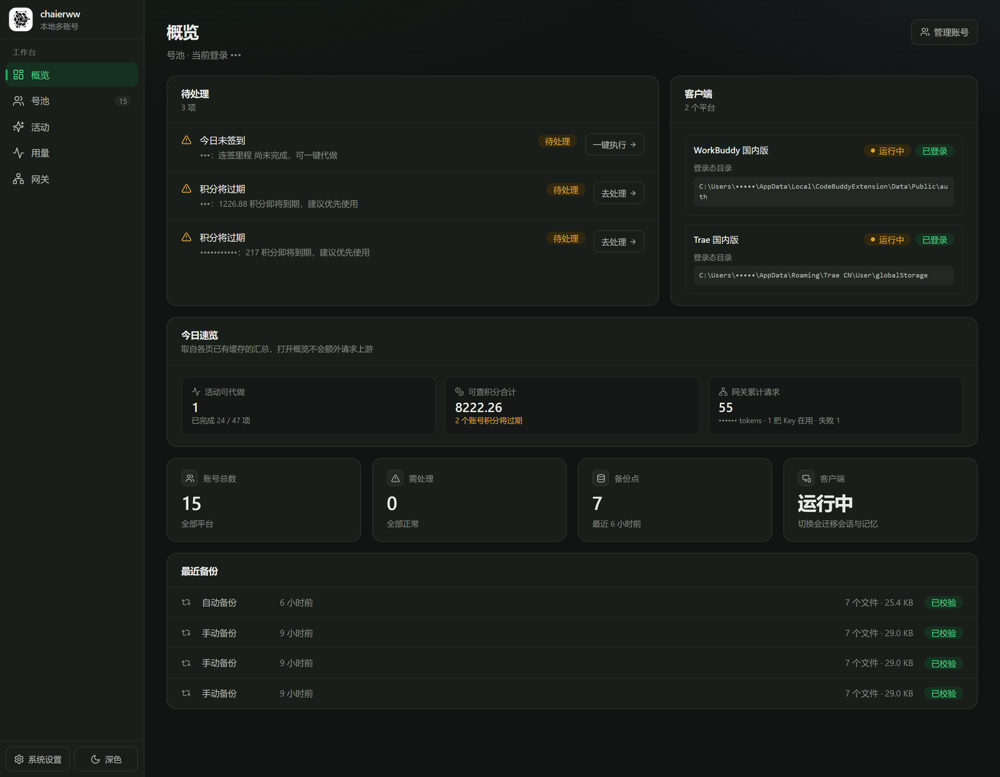
</p>

<p align="center">
  <b>Windows</b>: download <code>chaierww-Setup-&lt;version&gt;.exe</code> and run it (no admin rights)　
  <b>Linux x64</b>: download <code>chaierww-x64.AppImage</code>, <code>chmod +x</code>, run
</p>

## The numbers

Switch accounts five times a day and you are doing 1,800 switches a year.
At 60 seconds each that is 30 hours — **four working days** — spent waiting.
And not one of those seconds was something you wanted to do.

<p align="center">
  <b>1,800 / year</b>　·　<b>60s → 1s</b>　·　<b>0 servers</b>　·　<b>7 backups</b>　·　<b>1 shortcut</b>
</p>

|  | By hand | chaierww |
|:--|:--|:--|
| One switch | log out → scan → wait for sync → find your session, ~60s | one click, **1 second** |
| Failure | broken state, and you debug it yourself | automatic rollback to the pre-switch snapshot |
| Before touching anything | write first, find out later | read-only preview showing exactly which files change |
| Rotation | remember whose credits expire first | picks the next account by expiry time |
| Organizing accounts | notes and memory | free-form group tags, filter and bulk-assign |
| Backups | none | one automatic copy per day, last 7 kept |

It puts your WorkBuddy (China) and Trae (China) accounts in one place. Every switch is
backed up first and rolled back automatically if it fails, so your login state never ends
up corrupted. **All data stays on your own machine** — no cloud relay, no account hosting,
and switching works with the network unplugged.

> Unofficial third-party tool. Not affiliated with, authorized by, or endorsed by
> WorkBuddy or Trae. It reads and writes your local client auth data and makes requests
> on your behalf according to your configuration. Read the
> **[disclaimer](docs/policies/DISCLAIMER.md)** before use (Chinese).

## One day

The same features, translated into a day:

| Time | What you do | What it saves you |
| :-- | :-- | :-- |
| 09:00 | One click to your main account | log out, scan, wait for sync, find the session |
| 13:30 | Type two letters in `Ctrl+K`, switch to the backup | hunting through the pool, matching accounts, tracking expiry |
| 18:00 | Run today's activities in one click | opening each activity, ticking each step, finding manual entries |
| 02:00 | Nothing | the patrol renews credentials; 1h / 6h backoff, circuit-breaker after 3 failures |

Every item above can be turned off or rescheduled in the app. Nothing is decided for you.

## The edges

What it does, and what it does not. First, what we deliberately refuse to do:

| Not done | Why |
|:--|:--|
| Cloud relay, account hosting, account sharing | that would turn a tool into a service |
| Login on your behalf (collecting your password) | too much credential responsibility, and unnecessary |
| Patching the client binary | it only reads and writes state files |
| Uploading any data | everything stays local; even metrics are local-only counts, no third-party SDK |
| Bypassing platform quotas or risk controls | it manages your own accounts, it does not farm them |

Then the hard limits — these are constraints, not a roadmap:

| Not possible | Why |
| :-- | :-- |
| Moving Trae accounts between machines | tokens are bound to the device that issued them; a token imported elsewhere is rejected upstream (`20403`) — scan or import on this machine instead |
| Doing activities through the web version | there is no web-login path; activities only use client-equivalent local requests |
| Fully automating every growth task | 10 of them are marked complete through an API call rather than actually performed, so they are excluded from scheduled tasks by default and show a notice before a manual run |
| macOS | not ported, not shipped; `default_box()` raises `PlatformNotSupported` |
| Running the installer on CentOS 7 | artifacts link against glibc 2.31+; on 2.17 you get `GLIBC_2.28 not found` — run the backend from source instead |

## Interface

| Account pool · accounts, groups, credits, credential health in one view | Usage · requests and credits by model and day |
| --- | --- |
| 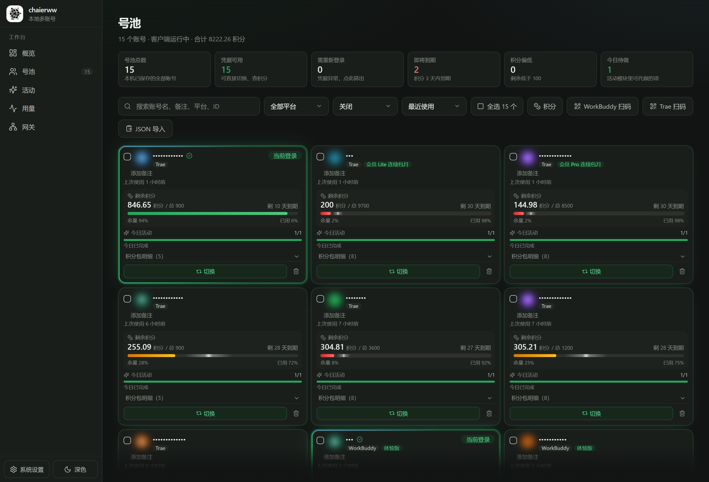 | 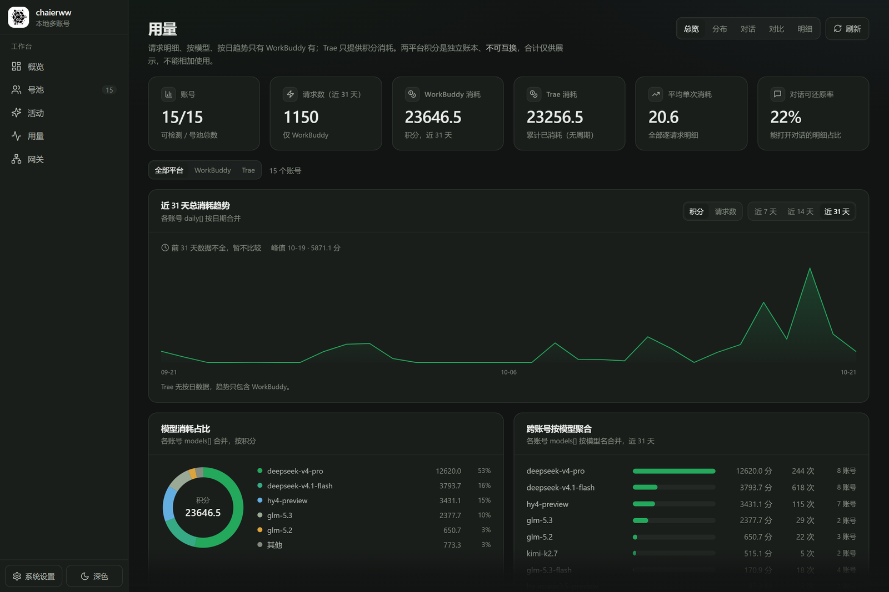 |

| Activity catalog · what exists, its rules and rewards | Per account · how far each account got, with manual steps explained |
| --- | --- |
| 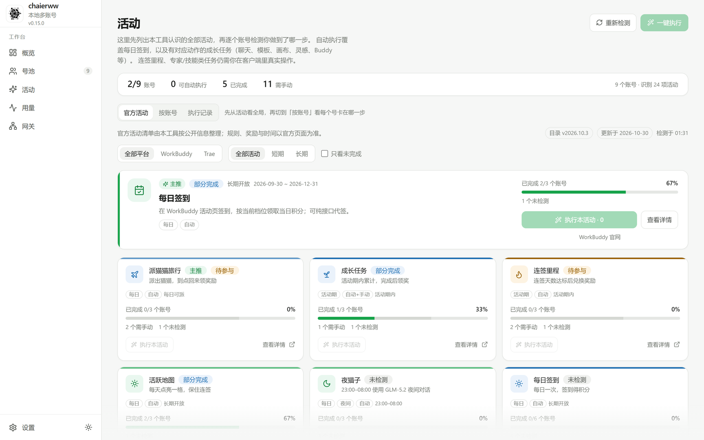 | 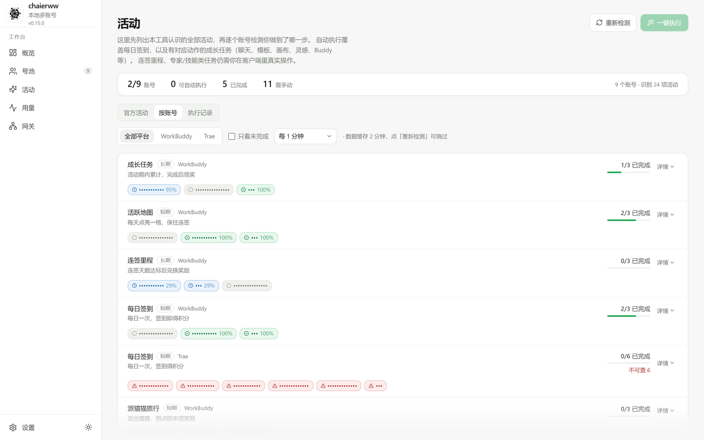 |

| Gateway · credits exposed as OpenAI / Anthropic-compatible endpoints | Model catalog · available models and capabilities |
| --- | --- |
| 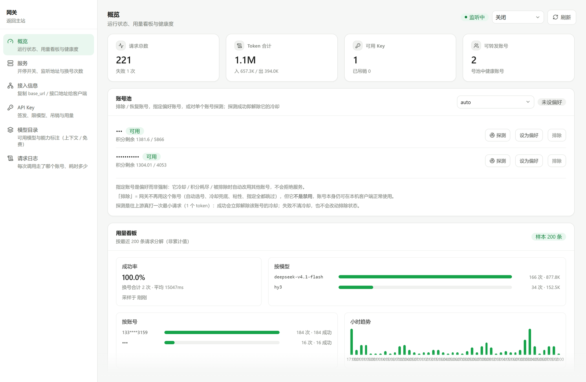 | 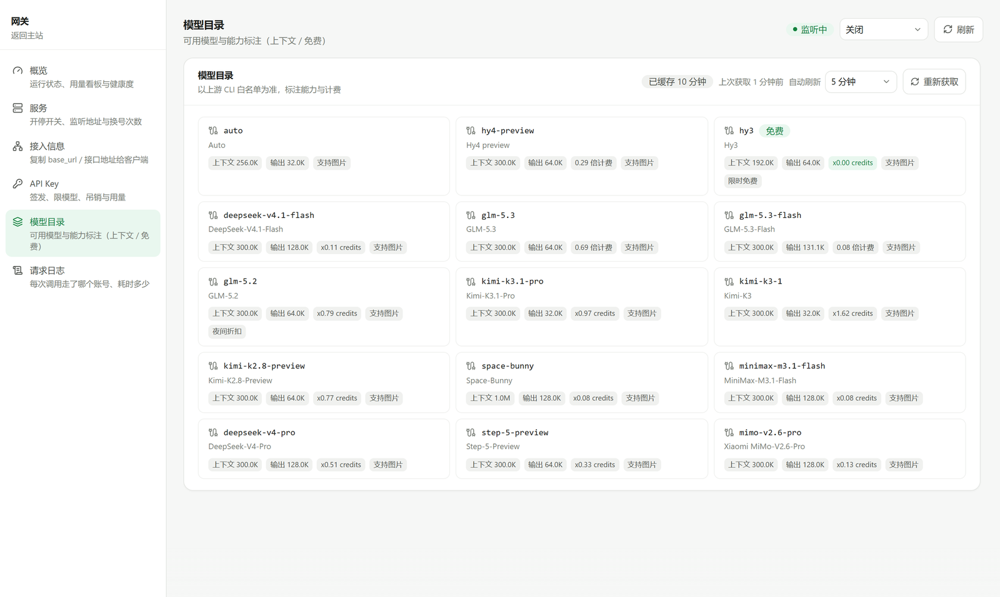 |

| Gateway keys · issue, restrict models, cap budget, revoke anytime | Scheduled tasks · multiple times a day, last 7 runs kept per slot |
| --- | --- |
| 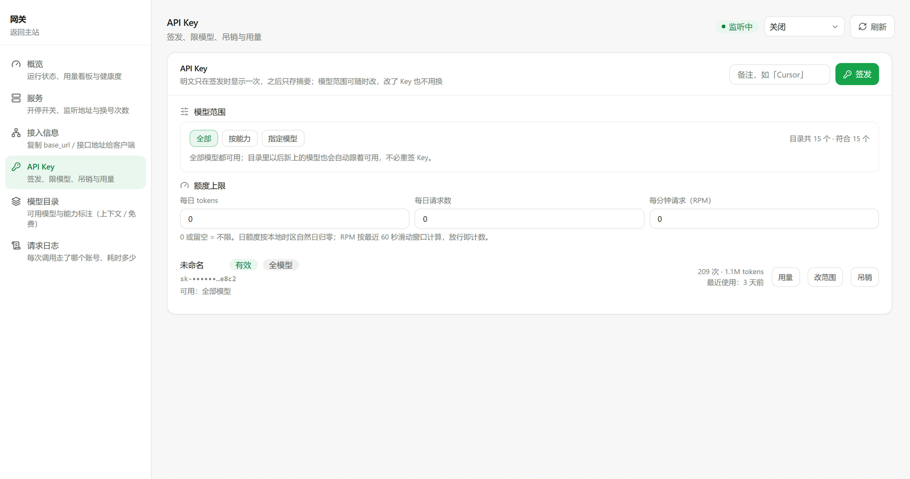 | 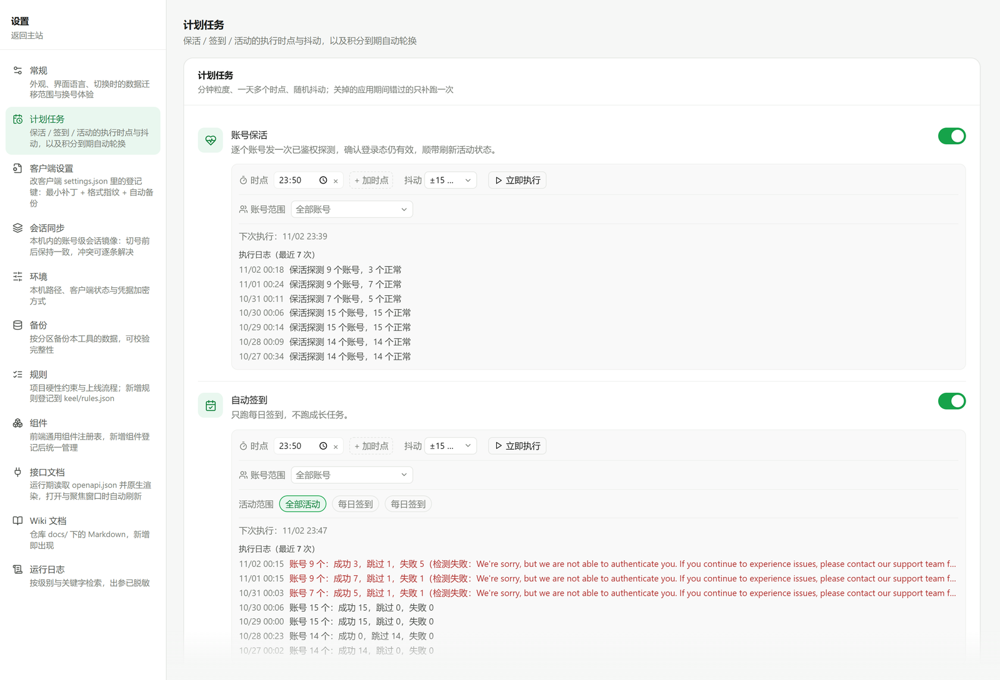 |

| Backup · one automatic copy per day, verifiable, restorable | Environment · local paths, client status, diagnostic bundle |
| --- | --- |
| 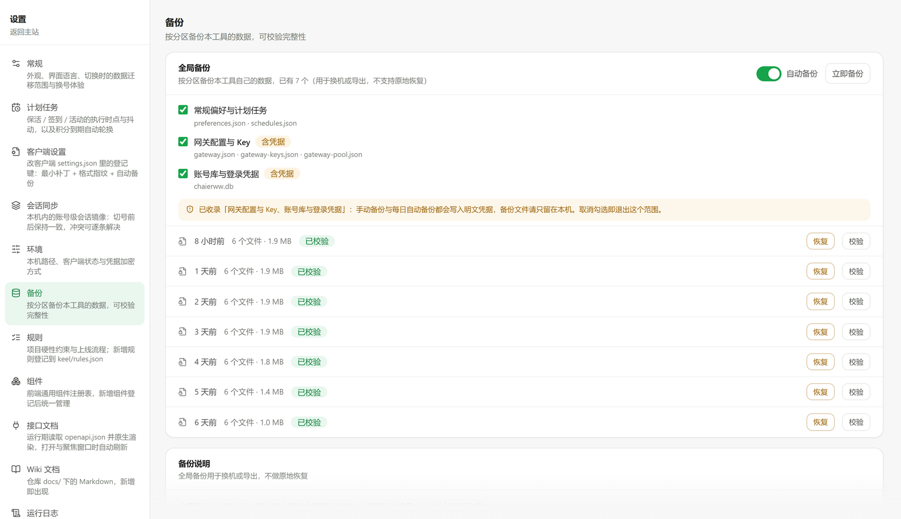 | 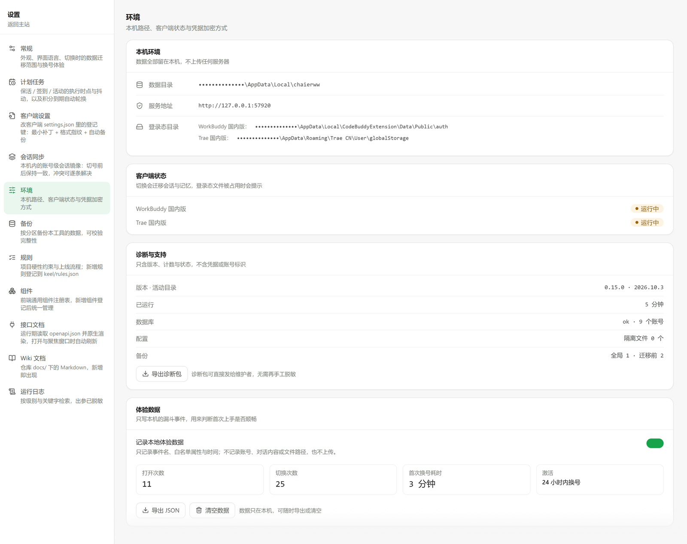 |

| General · which data to migrate, whether to relaunch after a switch | Run history · every activity run keeps its verdict and reason |
| --- | --- |
| 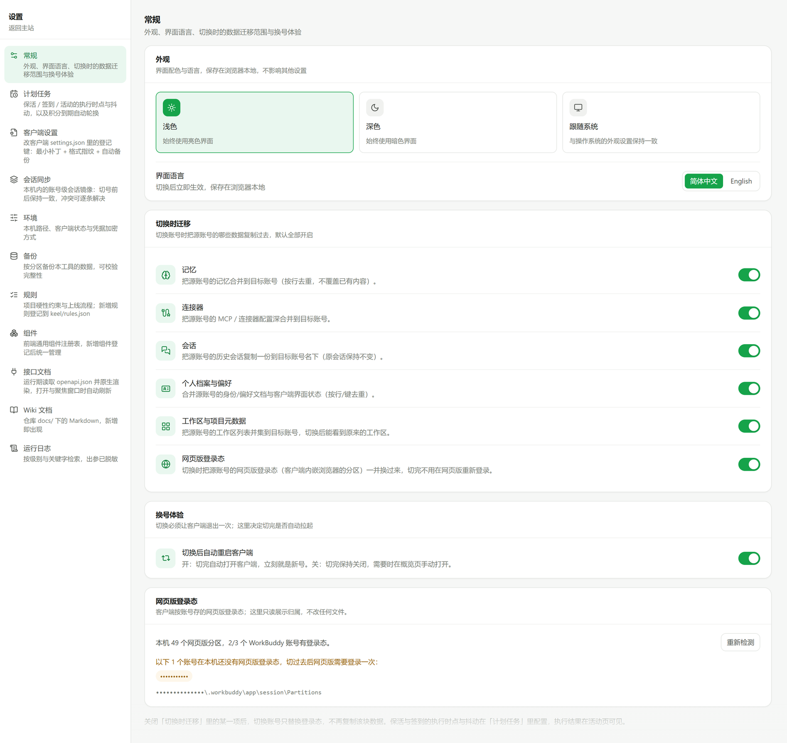 | 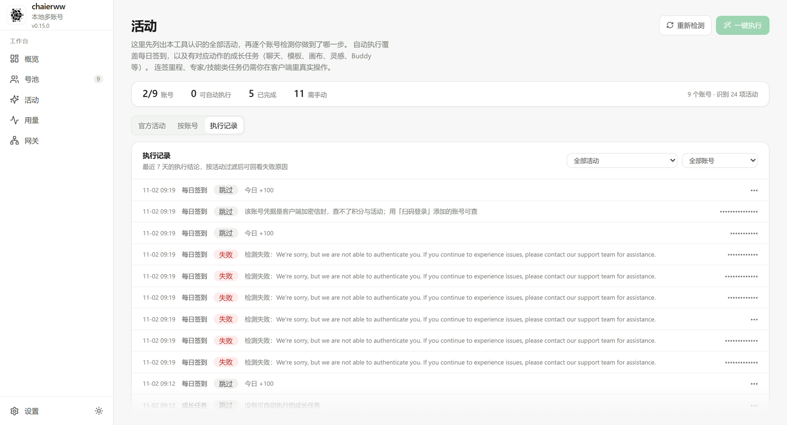 |

> Screenshots are taken after the DOM renders: account names, account IDs, emails, local
> paths, gateway keys and IPs are replaced with dots or blur inside the page before the
> shutter fires — not painted over manually afterwards, so layout changes do not need
> re-measuring. The data shown is anonymized demo data, produced by `python scripts/shots.py`.

## Features

Grouped by the four things you actually do, with only the sharpest bullets kept:

**Switching**

- **One click to switch**: from an account card, the `Ctrl+K` command palette (search as you
  type), or the desktop tray — all sharing one read-only preflight, with automatic rollback on failure
- **Look before you leap**: a read-only preview lists every file that would change; nothing is written
- **Relaunch under your control**: whether the client restarts after a switch is a setting, not a default

**Account pool**

- **Credentials renew themselves**: renewal starts early based on token lifetime (30 minutes to
  6 hours); failures back off at 1h / 6h, and three consecutive auth failures trip a circuit
  breaker with a one-click "resume auto-renew"
- **Problems surface on their own**: the overview "needs attention" list shows expired and
  near-expiry credentials (within 7 days) and links straight to the pool; what can be renewed
  is renewed, what cannot says "scan again" plainly
- **Diagnose before guessing**: a six-step read-only check (credential readable, renewable,
  device matches, remaining lifetime, backoff/breaker, read-only liveness) with a verdict and
  advice for each step — it writes nothing and rotates nothing
- **Groups and a recycle bin**: free-form tags, filter and bulk-assign by group; deleted accounts
  go to a 30-day recycle bin and can be restored

**Activities**

- **Official catalog ships with each version**: check-in, growth tasks, streak milestones,
  cat travel, night owl, back-to-school — each with rules and rewards; anything outside the
  catalog is marked "not covered" and sinks to the bottom instead of silently disappearing
- **Progress per account**: how far each account got, where it is stuck, and which steps can
  run automatically, on one screen; unsupported steps explain how to do them by family, and
  "re-check" verifies a manual step without a full reload
- **Visible returns**: today / last 7 days totals, a mini trend, and top 3 accounts — counting
  only rewards this tool performed and recorded, never manual claims

**Gateway**

- **Lend your quota to other local AI tools**: OpenAI / Anthropic-compatible endpoints, with
  keys you can issue and revoke, per-key daily token and request caps, and per-minute limits
- **Strategy-driven account selection**: `balanced` / `quality` / `quota` / `smart`, plus a
  minimum-credit threshold and per-account concurrency; when everything is saturated it
  returns `503` with `Retry-After: 1`
- **It does the books and warns early**: a 90-day daily ledger with credit snapshots; the
  forecast view shows a 14-day trend, each account's projected exhaustion date and each key's
  daily budget progress — and says `insufficient` when the data is too thin to guess

<details>
<summary>Everything else (scheduling, backups, sessions, onboarding, local telemetry)</summary>

- **Switch from anywhere**: account card, `Ctrl+K`, and tray all use the same preflight; relaunch-after-switch is configurable
- **Every run leaves a receipt**: one-click activity / renewal runs list successes, skips and failure reasons per item, retryable on the spot
- **If it cannot read, it says so**: a failed backup read shows "unavailable" with a retry; loading gets a skeleton, never a fake `0` or empty state
- **Patrol history**: each account keeps its last 20 patrol records — time, status, reason, next retry — across restarts; "resume" only clears the counter, not the history
- **Deleted by mistake?**: the recycle bin keeps accounts for 30 days; restore, purge early, or empty in one click
- **Run history and trends**: every run keeps its verdict and reason; details include a 14-day success / skip / failure bar trend
- **Usage** aggregated by model and by day, so you can see who is burning quota
- **The gateway keeps books**: every request leaves a per-hop account trail you can expand in the log; 429s honor upstream `Retry-After` (capped at 30 minutes); the pool explains why each account is excluded and for how long, and rate-limited accounts come back automatically
- **Forecasts only use complete days**: an average needs at least 2 days with requests, and an exhaustion date is only given when the balance actually dropped
- **Scheduled tasks**: multiple times per day with jitter, scoped to chosen accounts and activities, last 7 runs per slot, with reasons and per-account counts
- **Desktop notifications**: when accounts need a re-login the tray shows "N accounts need re-login" and sends one system notification per account per day, linking straight to credential health
- **Backups travel back in time**: snapshots can be verified and restored; restore applies before the database opens on next launch, and rolls back on failure
- **Sessions follow the account**: chat sessions and web-login state are mirrored between accounts on the same machine, so you can keep chatting after a switch; bodies are content-hashed and stored once, appends follow the source, deletions follow too, conflicts stay local and are resolved one by one; platforms without a local session store (Trae) are marked "unsupported" — sessions never cross machines
- **Self-diagnosis**: Settings → Environment offers a health panel and "export diagnostic bundle" containing versions, counts and redacted logs only
- **Onboarding that does not nag**: five steps on first launch (install the client → scan to add an account → first switch → keep it → run activities daily), skippable and collapsible; existing users are treated as done
- **Local experience data**: anonymous counters such as first-switch success rate and TTFV are written locally only, and can be disabled, exported or cleared under Settings → Environment → Experience data ([details](docs/policies/TELEMETRY.md), Chinese) — never uploaded

</details>

## Credentials

Every credential in the pool comes from one of two sources, and both renew automatically
over time:

- **Scan login**: stores `accessToken` / `refreshToken` together with the device key created
  during that login;
- **Import from the client**: stores the client's login-state envelope, with the device key
  encrypted alongside it.

Since October 2026, Trae requires a device signature (`DeviceProof`) on renewal requests, and
a token is only honored by the device that issued it. So:

- accounts added or imported here renew automatically on this machine for the long run;
- accounts exported from **another machine** are rejected upstream (`20403`, device mismatch)
  and the card says "bound to another device" — scan or import again on this machine;
- when the upstream clearly refuses (`20101` / `20403` and similar), the app stops pretending
  the account is usable and downgrades it to "needs re-login".

**Patrol schedule**: 08:00 and 20:00 daily (can be disabled). Before each patrol it pulls the
login state of the account currently signed in to the client back into the pool, so the
client's own token rotation cannot invalidate the stored copy. The upstream is only contacted
once a credential enters its renewal window, computed from token lifetime:

```text
window = min(6h, lifetime × 10%), floor 30 minutes
```

Failures are not retried immediately: wait 1 hour after the first, 6 hours after the second,
and after three consecutive auth failures the breaker trips until you log in again. The card
shows the last patrol, last renewal, failure reason and next retry, with two repair buttons
("scan again" / "import from client") right there. After a breaker trip, "resume auto-renew"
clears the failure count and keeps the history. For finer detail, "diagnose" runs six read-only
checks.

## Install

Download the latest build from [Releases](https://github.com/Chaierss/workbuddy-trae-assist/releases).

- **Windows**: `chaierww-Setup-<version>.exe`. Double-click. Installs per-user by default,
  no admin rights, into your user directory; the wizard shows the license highlights and
  disclaimer first.
- **Linux x64**: `chaierww-x64.AppImage` (`chmod +x`, and add
  `APPIMAGE_EXTRACT_AND_RUN=1` if FUSE is missing) or `chaierww-x64.deb`
  (`sudo apt install ./….deb`). **CentOS 7 with glibc 2.17 will not run** — see [The edges](#the-edges).

Then scan a QR code to add an account, and from then on switching is one click.

The installer is not code-signed, so Windows will block it once on first run:
choose "More info → Run anyway". That is the cost of not buying a certificate, not a
sign of a bad package.

**Upgrades take care of themselves.** The app checks and downloads updates silently at
startup; only when the download finishes does it show a note in the sidebar, the tray and
Settings → General, without interrupting you. "Restart and install" applies it immediately;
"Later" installs it the next time you quit. Turn automatic checks off under Settings → General,
where manual checks also live. If you do not want a particular version, choose "skip this version".

### Platforms

| Platform | Artifact | Notes |
| :-- | :-- | :-- |
| Windows 10 / 11 (x64) | `chaierww-Setup-<version>.exe` | fully supported |
| Linux x64 (Ubuntu 20.04+ / Debian 11+ / CentOS 8+) | AppImage, deb | fully supported, except CentOS 7 |
| macOS | — | not ported, not shipped |

Linux differs from Windows in exactly three places: credential encryption (Windows DPAPI /
Linux AES-256-GCM with a key derived from `/etc/machine-id` + uid, never written to disk),
login-state directory (`APPDATA` ↔ `XDG_CONFIG_HOME`), and the client process name
(no `.exe`). Linux AES **protects ciphertext copied to another machine but not against local
root** — see [SECURITY.md](SECURITY.md) (Chinese).

**CentOS 7 users**: either `pip install -e .` and run `python -m chaierww.main`, then open
`http://127.0.0.1:57910` — or build the package on that machine yourself (PyInstaller cannot
cross-compile). See [desktop/README.md](desktop/README.md) and
[docs/LINUX.md](docs/LINUX.md) (Chinese) for the full steps (installing Python 3.11, building
the frontend, remote access). To keep it running on a server after you log out of SSH:
`bash scripts/install-linux.sh --systemd`.

macOS is still unported: the backend has no Keychain implementation. The Electron shell,
tray and build scripts are cross-platform, so PRs are welcome — see [Development](#development).

## Security

- Credentials are encrypted at rest with keys that never touch a file: DPAPI on Windows
  (bound to the current user), AES-256-GCM on Linux (derived from machine-id + uid, not
  root-proof); logs are always redacted
- The local API is guarded by default: same-origin browser cookies pass, external scripts use
  `~/.chaierww/api-token`, and any non-loopback `Host` / `Origin` is rejected
  ([details](docs/README.md), Chinese)
- Config and database writes are atomic: temp file + fsync + rename; corrupt JSON is quarantined
  with evidence instead of silently overwritten
- Everything lives in `~/.chaierww` (override with `CHAIERWW_HOME`); copying that directory
  migrates the whole install
- There is no server. Unplug the network and switching still works

See **[SECURITY.md](SECURITY.md)** (Chinese) for the threat model.

## FAQ

**The client doesn't start after a switch, or exits immediately?**
Check "Overview → Client" for the install state. Switching uses the same system call as
double-clicking the icon; if it still fails, the path is usually wrong or the client is
updating — verify the login directory under Settings → Environment.

**How do I stop the client from launching after a switch?**
Turn off "restart client after switching" under Settings → General → Switch experience. Only
the login state is changed; the client stays closed until you open it.

**Will I get banned?**
Check-in calls the platform's own API once on your behalf, with headers and parameters shaped
like the client's own behavior — no concurrent logins, no patching. But **growth tasks are
different**: 10 of them mark a task complete through an API call instead of actually doing it
in your client. That path is weaker, so scheduled tasks exclude them by default and a manual
run shows a notice first. Every third-party tool carries risk, and **you assume that risk**.

**Do backups eat much disk?**
The rolling backup keeps 7 copies at roughly 30 MB each, about 200 MB steady state. The
temporary pre-switch backup is deleted as soon as the switch succeeds.

**Do you use my data for analytics?**
Only locally. The app records 7 anonymous events (app opened, client detected, an onboarding
step completed, account added, preview, successful switch, gateway key issued) with enum-only
attributes such as language, platform and step; no account names, account IDs, credentials,
conversation text or paths. Data stays in `~/.chaierww/metrics/events.ndjson`, is never
uploaded, and can be disabled, exported or cleared under Settings → Environment → Experience
data. See the **[local experience data note](docs/policies/TELEMETRY.md)** (Chinese).

**Will upgrading lose my data?**
No. `~/.chaierww` is separate from the install directory, so overwriting the install leaves
data alone, and daily backups keep running. Uninstalling keeps your data by default too —
only ticking "also delete my data" in the uninstall wizard removes it.

## Development

The repository is complete: credential encryption, the switch engine and both client
adapters are in `src/chaierww/`. Clone and run — no private packages to request.

```bash
git clone https://github.com/Chaierss/workbuddy-trae-assist.git
cd workbuddy-trae-assist
python -m venv .venv
.venv/Scripts/activate                # macOS / Linux: source .venv/bin/activate
pip install -e ".[dev]"

python -m chaierww.main               # http://127.0.0.1:57910/
pytest                                # 786 tests
ruff check src tests
```

Desktop packaging: the frontend is in `web/` (`npm ci && npm run build`), the Electron shell
in `desktop/`; see [desktop/README.md](desktop/README.md) (Chinese).

```
src/chaierww/
  adapters/    client login-state readers: workbuddy.py / trae.py, slot contract in base.py
  domain/      switch engine, activity check-in, credits, quota gateway, scheduling, rotation
  infra/       credential encryption (secrets.py), SQLite, parent-process guard
  api/         local HTTP API shared by the desktop app and the frontend
web/           Vue 3 + TypeScript + Tailwind frontend
desktop/       Electron shell, tray, auto-update, PyInstaller packaging
scripts/       build, screenshot redaction, diagnostics
tests/         pytest suite (786 tests)
```

To add a client, read the slot contract in `adapters/base.py`: one new adapter is enough,
and the switch engine stays untouched. Linux is already in the CI matrix (`ubuntu-latest`); macOS
is not — add a Keychain implementation in `infra/secrets.py`, then add `macos-latest` to
`build-desktop.yml`.

### Docs

| Document | What it covers |
| :-- | :-- |
| [README.md](README.md) | 简体中文主页 |
| [docs/QUICKSTART.en.md](docs/QUICKSTART.en.md) | 3-minute quick start: install, add an account, preview, switch, common failures |
| [docs/QUICKSTART.md](docs/QUICKSTART.md) | Same quick start in Chinese |
| [docs/LINUX.md](docs/LINUX.md) | Linux deployment: packages, backend from source, CentOS 7, SSH tunnels |
| [CONTRIBUTING.md](CONTRIBUTING.md) | Conventions, commit style, testing |
| [SECURITY.md](SECURITY.md) | Security model, vulnerability reporting |
| [CHANGELOG.md](CHANGELOG.md) | What changed in each release |
| [desktop/README.md](desktop/README.md) | Packaging, auto-update, installer troubleshooting |
| [docs/policies/DISCLAIMER.md](docs/policies/DISCLAIMER.md) | Disclaimer (read before use) |
| [docs/policies/TELEMETRY.md](docs/policies/TELEMETRY.md) | Local experience data: what, where, how to turn it off |

## License

[PolyForm Noncommercial License 1.0.0](LICENSE).

**All source is public, but this is not an OSI-approved open-source license.** The accurate
term is source-available:

- ✅ personal use, study, modification, redistribution for non-commercial purposes
- ❌ any commercial use — including internal company use, bundling into commercial products,
  or offering a paid service
- commercial use requires separate permission from the author
  ([open an issue](https://github.com/Chaierss/workbuddy-trae-assist/issues) to get in touch)

```
Required Notice: Copyright (c) 2026 NextAgentX (https://github.com/NextAgentX/qoder-trae-workbuddy-switch)
Required Notice: Copyright (c) 2026 Chaierss (https://github.com/Chaierss)
```

The first line belongs to the upstream project: Trae credential-envelope parsing
(`domain/trae_crypto.py`) and scan login (`domain/trae_oauth.py`) began from protocol research
on [qoder-trae-workbuddy-switch](https://github.com/NextAgentX/qoder-trae-workbuddy-switch) —
a Rust/Tauri implementation under the same license, rewritten here in Python. Under PolyForm's
Notices clause the upstream Required Notice must be kept and is not removed.

---

If it saves you those logout-login rounds every day,
[a star](https://github.com/Chaierss/workbuddy-trae-assist/stargazers) is enough; forwarding
it to someone else juggling several accounts helps more.
Questions go to [issues](https://github.com/Chaierss/workbuddy-trae-assist/issues),
and [CONTRIBUTING.md](CONTRIBUTING.md) covers getting involved.
