<h1 align="center">chaierww</h1>

<p align="center">
  <b>一年换号 1800 次，等于白扔 4 个工作日。</b><br>
  <sub>WorkBuddy 国内版 + Trae 国内版的多号切换，现在只要点一下。全部在本机，断网也能用。</sub>
</p>

<p align="center">
  
  
  
  <a href="https://github.com/Chaierss/workbuddy-trae-assist/releases"></a>
</p>

<p align="center">
  <a href="README.en.md">English</a> ·
  <a href="docs/QUICKSTART.md"><b>3 分钟上手</b></a> ·
  <a href="#安装">下载安装</a> ·
  <a href="#界面">界面</a> ·
  <a href="#功能">功能</a> ·
  <a href="#常见问题">常见问题</a> ·
  <a href="#开发">开发</a>
</p>

<p align="center">
  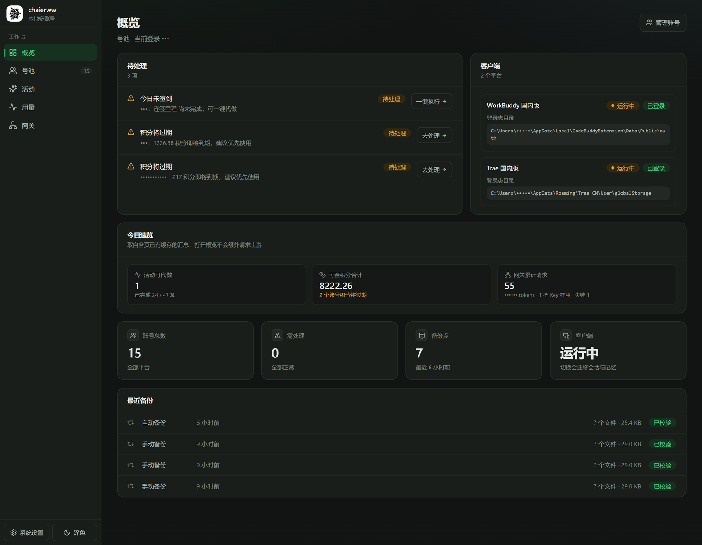
</p>

<p align="center">
  <b>Windows</b>：下载 <code>chaierww-Setup-&lt;版本号&gt;.exe</code> 双击安装（免管理员）　
  <b>Linux x64</b>：下载 <code>chaierww-x64.AppImage</code>，<code>chmod +x</code> 后运行
</p>

## 数字

一天换五次号，一年就是一千八百次。每次六十秒，累计三十个小时——**四个工作日**，
全花在「等一下」上。而且每一次，都不是你想做的事。

<p align="center">
  <b>1800 次/年</b>　·　<b>60 秒 → 1 秒</b>　·　<b>0 台服务器</b>　·　<b>7 份备份</b>　·　<b>1 个快捷键</b>
</p>

|  | 手动 | chaierww |
|:--|:--|:--|
| 切号动作 | 退出 → 扫码 → 等同步 → 找回会话，约 60 秒 | 点一下，**1 秒** |
| 失败处理 | 状态写坏了自己排查 | 自动回滚到切换前快照 |
| 动手之前 | 直接改，坏了才知道 | 只读预演，先看会动哪些文件 |
| 多号轮换 | 手动记谁的积分先到期 | 按到期时间自动挑号 |
| 多号归类 | 靠备注和记忆分清谁是谁 | 分组标签，按组筛选、批量设组 |
| 备份 | 没有 | 每日自动一份，滚动保留 7 份 |

它把 WorkBuddy 国内版和 Trae 国内版的账号收进一处，切换前强制备份、中途失败自动回滚，
不会把登录态写坏。**所有数据只在你自己的机器上**：没有云端中转，没有账号托管，断网也能切号。

> 非官方第三方工具，与 WorkBuddy / Trae 及其权利人无隶属、授权或背书关系。
> 它会读写本机客户端的认证数据、按你的配置自动发起请求。使用前请读
> **[免责声明](docs/policies/DISCLAIMER.md)**。

## 一天

把功能换成你的一天，省下的是这些动作：

| 时间 | 你做的事 | 它替你省掉的 |
| :-- | :-- | :-- |
| 09:00 | 点一下，切到主力号 | 退出、扫码、等同步、找回会话 |
| 13:30 | `Ctrl+K` 输两个字，切备用号 | 翻号池、对账号、记谁的积分先到期 |
| 18:00 | 一键跑当天活动 | 逐个活动点进去、逐项点完成、手动项找入口 |
| 02:00 | 什么都不做 | 巡检自动续期；失败按 1 小时 / 6 小时退避，连续三次熔断 |

以上每一项都能在应用里关掉或改时间，不存在替你决定。

## 边界

能做和不能做，一次说清。先说不做的：

| 不做 | 原因 |
|:--|:--|
| 云端中转、账号托管、账号分享 | 会让工具变成服务 |
| 代登录（收集你的密码） | 凭据责任过重，且没必要 |
| 修改客户端程序本体 | 只读写状态文件，不打补丁 |
| 上传任何数据到服务器 | 数据只落本机：统计也只有本机匿名计数，不上传、不接第三方 SDK |
| 绕过平台额度或风控 | 它帮你管自己的号，不帮你薅 |

再说做不到的，这些是硬限制，不是排期：

| 做不到 | 说明 |
| :-- | :-- |
| 跨设备搬号 | Trae 令牌绑定签发设备，别处导出的号会被上游拒绝（`20403`），需在本机重新扫码或导入 |
| 网页版做活动 | 不提供网页登录链路，活动只走与客户端等价的本地请求 |
| 把成长任务全自动做完 | 其中有 10 项是通过接口把任务标记完成，并非真的执行动作；默认不进计划任务，手动执行前会弹说明 |
| macOS | 未适配，不发布；`default_box()` 会抛 `PlatformNotSupported` |
| 在 CentOS 7 上跑安装包 | 产物链接 glibc 2.31+，2.17 系统直接报 `GLIBC_2.28 not found`，只能源码跑后端 |

## 界面

| 号池 · 账号、分组、积分、凭据状态一屏看全 | 用量 · 请求 + 积分，按模型、按日趋势 |
| --- | --- |
| 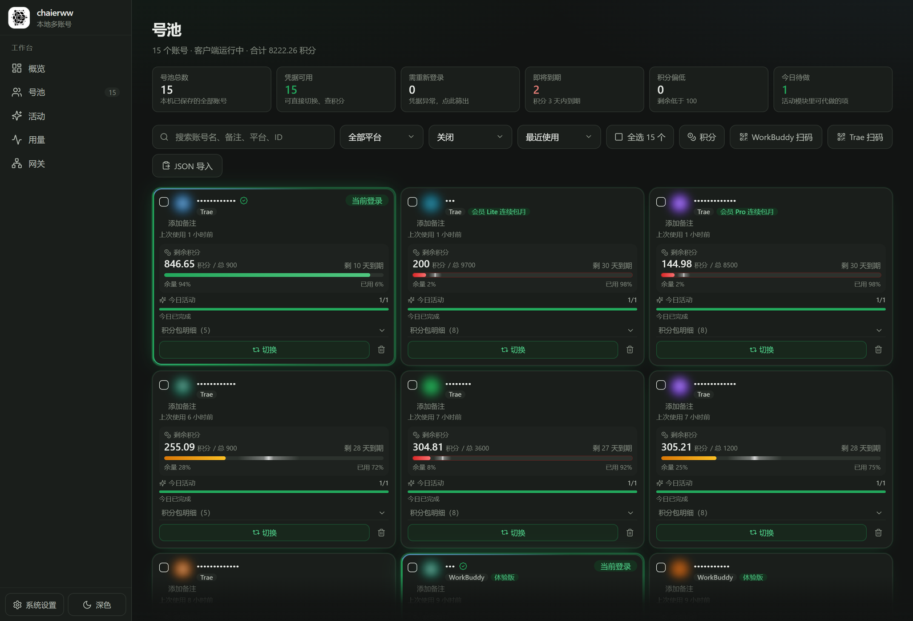 | 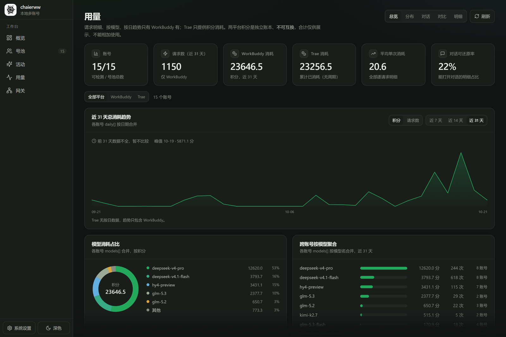 |

| 活动目录 · 平台有哪些活动、规则与奖励 | 按账号 · 每个号做到哪一步、手动项写着怎么做 |
| --- | --- |
| 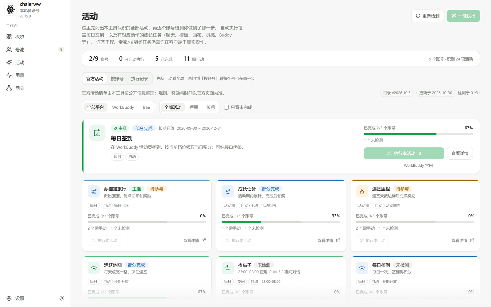 | 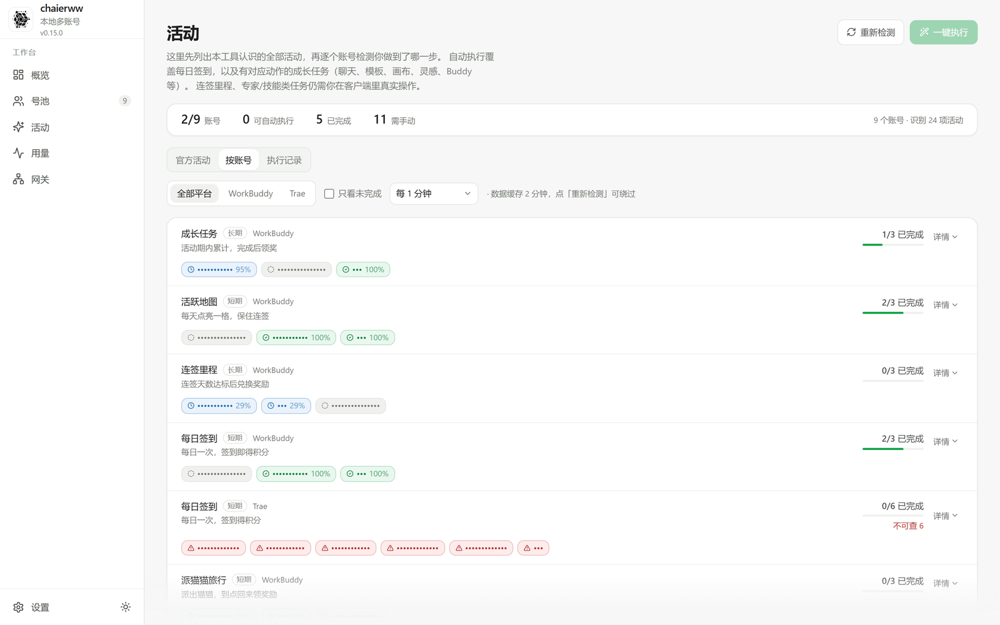 |

| 网关 · 额度以 OpenAI / Anthropic 兼容接口开放 | 模型目录 · 可用模型与能力标注 |
| --- | --- |
| 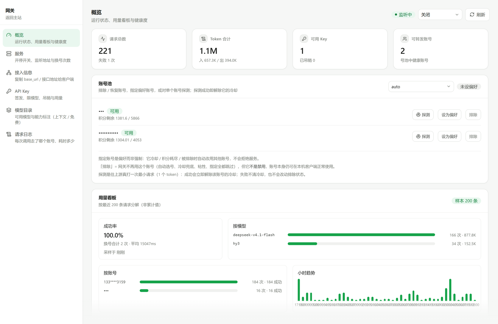 | 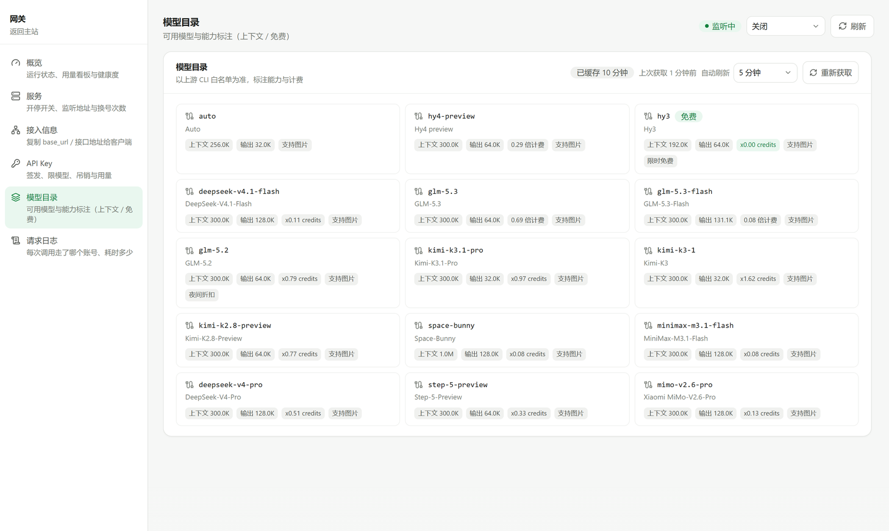 |

| 网关 Key · 签发、限模型、限额度、随时吊销 | 计划任务 · 一天多个时点，每档只留最近 7 次执行记录 |
| --- | --- |
| 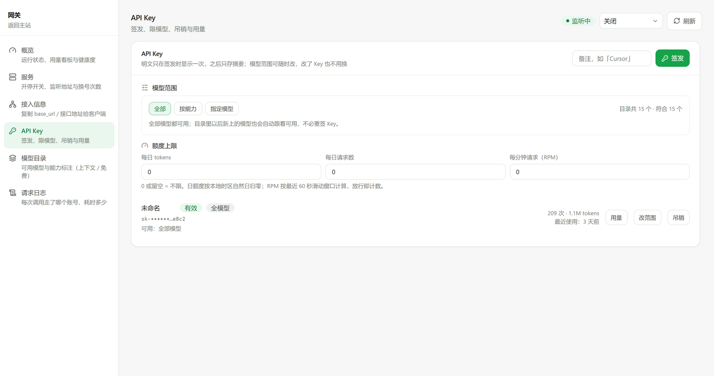 | 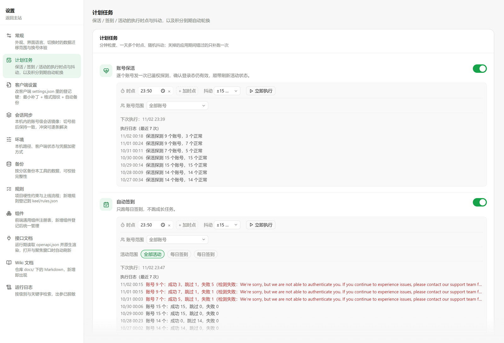 |

| 备份 · 每日自动一份，可校验、可回到任意一份 | 环境 · 本机路径、客户端状态与诊断包 |
| --- | --- |
| 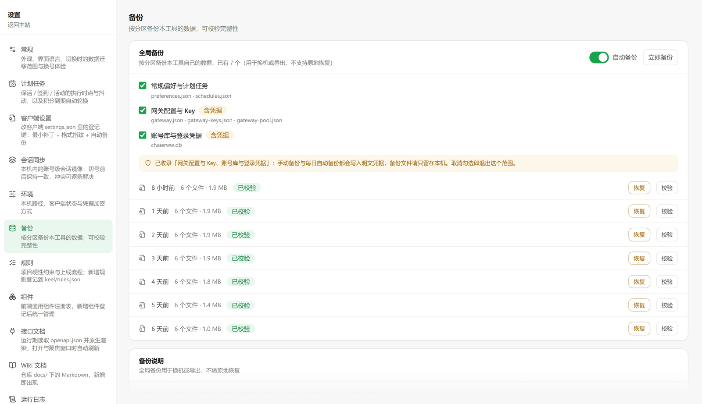 | 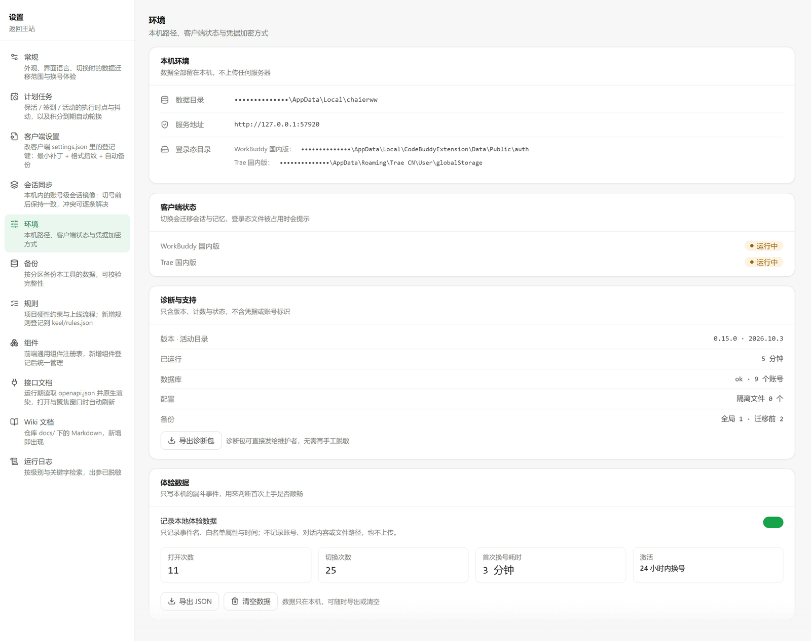 |

| 常规 · 迁移哪几类数据、切完是否自动拉起，逐项可控 | 执行记录 · 每次跑活动都留结论与原因 |
| --- | --- |
| 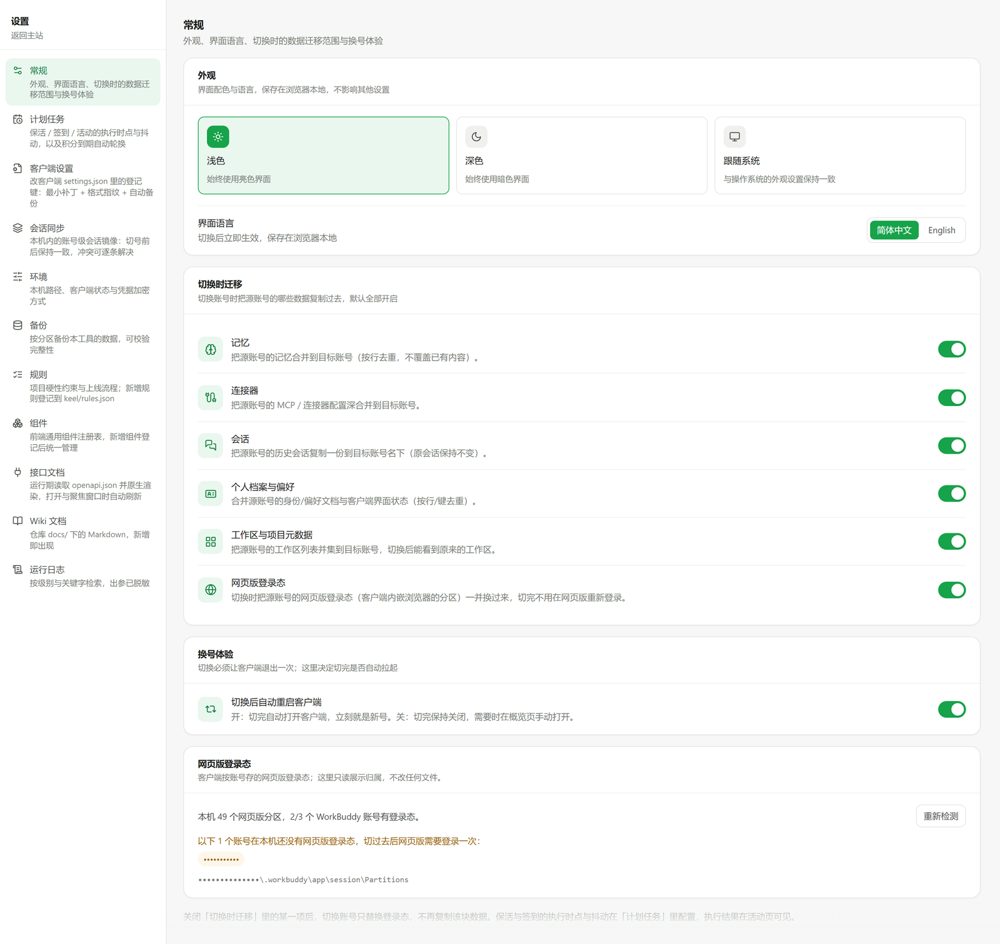 | 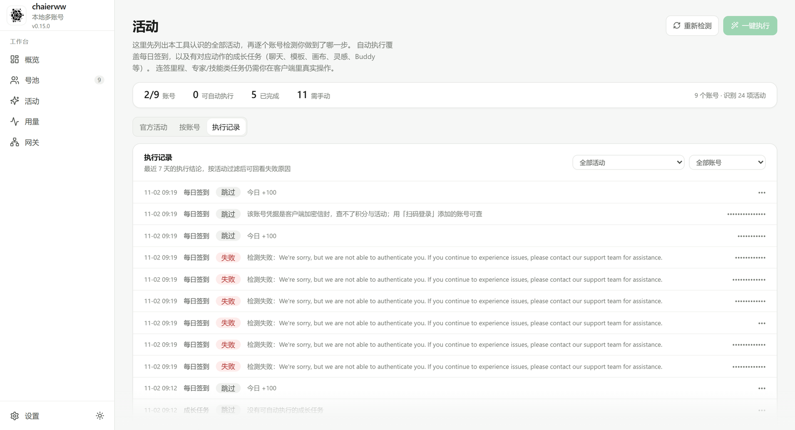 |

> 截图是脚本渲染完 DOM 再截的：账号名、账号 ID、邮箱、本机路径、网关 Key、IP
> 在快门按下之前就已经在页面里被替换成圆点或模糊，不是事后按坐标手画的，
> 所以界面改版也不用重新量坐标。图为脱敏后的演示数据，生成方式是 `python scripts/shots.py`。

## 功能

按你实际会用的四件事归类，每类只留最硬的几条：

**换号**

- **点一下就换**：号池卡片、`Ctrl+K` 命令面板（输入即搜账号）、桌面托盘三处都能发起，
  走同一套只读预检；失败自动回滚到切换前快照
- **先看再动手**：切换前只读预演，列出会动哪些文件，不写一个字节
- **切完自己拉起**：是否自动重启客户端可在「设置 → 常规 → 换号体验」关掉

**号池**

- **凭据会自己续**：按令牌寿命动态提前续期（最短 30 分钟、最长 6 小时）；失败按
  1 小时 / 6 小时退避，连续失败自动熔断，熔断后可一键「恢复自动续期」
- **该处理的自己冒出来**：概览「待处理」列出已过期与七天内到期的凭据，点进去直达号池；
  能续的直接续，不能续的如实说明「需要重新扫码」
- **出问题先诊断**：六步只读诊断（凭据可读、能否续期、设备是否本机、剩余寿命、退避/熔断、
  只读验活），每步给结论与建议，不写数据、不轮换令牌
- **分组与回收站**：自由标签按组筛选、批量设组；删除先进回收站保留 30 天，可恢复

**活动**

- **官方目录随版本走**：签到、成长任务、连签里程、派猫猫旅行、夜猫子、开学季逐条写清
  规则与奖励；目录外的活动标「未收录」沉底，不会静默消失
- **按账号看进度**：每个号做到第几步、卡在哪一项、哪几项可自动跑，一屏说清；
  做不了的项按族写清「怎么做」，手动做完点「重新检测」当场回查
- **收益看得见**：今日 / 近 7 天合计、迷你趋势与 Top 3 账号；只算本工具代做并记录下来的
  奖励，手动领取不计

**网关**

- **额度借给本机其它 AI 工具**：以 OpenAI / Anthropic 兼容接口开放，Key 可签发、可吊销，
  可按 Key 配每日 Token / 请求数与每分钟上限
- **选号有策略**：`balanced` / `quality` / `quota` / `smart` 四档，可设最低积分门槛与
  每号并发上限；全部占满时快速回 `503` + `Retry-After: 1`
- **会算账、会预警**：90 天日级账本另存积分快照，「用量预测」给 14 天趋势、每号预计耗尽日
  与每把 Key 的当日预算进度；数据不足时如实显示 `insufficient`

<details>
<summary>其余细节（计划任务、备份、会话、引导、体验数据等）</summary>

- **换号随处可发起**：号池卡片、`Ctrl+K`、托盘三处走同一套预检，切完是否自动拉起可配置
- **执行有回执**：一键执行活动 / 续期后逐项列出成功、跳过与失败原因，失败可当场重试
- **读不到就说读不到**：备份读取失败显示「暂不可查」并可重试，加载中给骨架，不拿 0 或空态冒充
- **巡检有历史**：每号保留最近 20 条巡检记录，卡片上可翻看时间、状态、原因与下次重试；
  重启不丢，「恢复」也只清计数、不删历史
- **删错了能捞回来**：回收站保留 30 天，可恢复，也可提前彻底删除或一键清空
- **执行记录与趋势**：每次执行留结论与原因，详情里给 14 天成功 / 跳过 / 失败柱状趋势
- **用量**按模型、按日归集，谁在烧额度一眼看出
- **网关会算账**：每次请求留下逐跳换号轨迹，日志可展开查看；429 尊重上游 `Retry-After`
  （封顶 30 分钟）；池里每个号为什么被排除、还剩多久都写清楚，上游限流 / 异常的排除到点自动复活
- **预测只算完整自然日**：至少 2 天有请求才给日均，余额没有真实下降就不猜耗尽日
- **计划任务**：一天多个时点与随机抖动，可限定账号范围与活动范围，每档只留最近 7 次执行记录，
  成功失败都带原因，还能展开看逐号计数
- **桌面端会提醒**：有号需要重登时，托盘显示「N 个号需重登」并发一条系统通知，
  同一账号每天最多一次，点击直达凭据健康度
- **备份能回到过去**：快照可校验，也能选定一份恢复；恢复在下次启动、数据库打开前应用，失败自动回滚
- **会话跟着号走**：同机不同账号之间镜像聊天会话与网页版登录态，切号后接着聊；
  正文按内容哈希只存一份，源端续写只追加、删除会跟随，冲突保留本地并可逐条处理；
  Trae 等没有本地会话库的平台明确标注「不支持」，不跨设备
- **出问题能自救**：设置 → 环境给出健康度面板与「导出诊断包」，只含版本、计数与脱敏日志
- **新装不迷路**：首启五步清单（装客户端 → 扫码加号 → 第一次换号 → 留下 → 每天一键跑活动），
  可跳过、可折叠；装过号的老用户自动视为已完成
- **本地体验数据**：首次成功换号率、TTFV 这类匿名计数只写本机，可在「设置 → 环境 → 体验数据」
  关闭、导出与清空（[说明](docs/policies/TELEMETRY.md)），不上云

</details>

## 凭据

号池里的每一份凭据只有两种来源，两种都会长期自动续期：

- **扫码登录**：保存 `accessToken` / `refreshToken` 与本次登录生成的设备私钥；
- **从客户端导入**：保存客户端登录态信封，设备私钥跟着信封一起加密落盘。

Trae 2026-10 起，续期请求必须带设备签名（`DeviceProof`），令牌只认签发它的那台设备。
所以：

- 本工具登录 / 导入的号，能在本机长期自动续期；
- 从**别的机器**导出的号会被上游拒绝（`20403` 设备不匹配），卡片标「设备绑定其他设备」，
  需要在本机重新扫码或重新导入；
- 上游明确拒绝（`20101` / `20403` 等）时不再假装可用，直接降级为「需重新登录」。

**巡检节奏**：每天 08:00 / 20:00 各一次（可关）。巡检前先把「客户端当前登录的号」的
登录态收回号池，避免客户端自己轮换 refreshToken 后号池那份被作废。只有进入续期窗口
才会真正请求上游，窗口按令牌寿命计算：

```text
提前窗口 = min(6h, 寿命 × 10%)，下限 30 分钟
```

失败不会立刻重试：第 1 次失败后等 1 小时，第 2 次后等 6 小时，连续 3 次认证失败
直接熔断，等用户重新登录。卡片上能看到上次巡检、上次续期与失败原因、下次重试时间，
并就地给出「重新扫码登录」「从客户端导入」两个修复按钮；熔断后点「恢复自动续期」
只清失败计数、保留历史。需要更细的现场信息时点「诊断」，六步检查全部是只读的。

## 安装

到 [Releases](https://github.com/Chaierss/workbuddy-trae-assist/releases) 下载最新版。

- **Windows**：`chaierww-Setup-<版本号>.exe`，双击安装。默认只为当前用户装、免管理员，
  装进当前用户目录；向导会先展示许可要点与免责声明。
- **Linux x64**：`chaierww-x64.AppImage`（`chmod +x` 后运行，缺 FUSE 时加
  `APPIMAGE_EXTRACT_AND_RUN=1`）或 `chaierww-x64.deb`（`sudo apt install ./…deb`）。
  **CentOS 7 的 glibc 2.17 跑不起来**，见[边界](#边界)。

打开后扫码加号，之后点一下就能切过去。

安装包没有代码签名，Windows 首次运行会拦一次：点「更多信息 → 仍要运行」。
这是没有付费证书的成本，不是包有问题。

**升级不用管。** 启动后自动静默检查并下载更新；下载完成才在侧栏、托盘和「设置 → 常规」里提示，
不打断当前操作。点「重启并安装」立即生效，选「稍后」则下次退出应用时自动装上。
不想让它自动检查，在「设置 → 常规」里关掉开关；手动检查也在那里。某个版本不想装，
可以在提示里点「跳过此版本」。

### 平台

| 平台 | 产物 | 说明 |
| :-- | :-- | :-- |
| Windows 10 / 11 (x64) | `chaierww-Setup-<版本号>.exe` | 完整支持 |
| Linux x64（Ubuntu 20.04+ / Debian 11+ / CentOS 8+） | AppImage、deb | 完整支持，CentOS 7 除外 |
| macOS | — | 未适配，不发布 |

Linux 与 Windows 的实现差异只有三处：凭据加密（Windows DPAPI / Linux AES-256-GCM，
密钥由 `/etc/machine-id` + uid 派生、不落盘）、登录态目录（`APPDATA` ↔ `XDG_CONFIG_HOME`）、
客户端进程名（去 `.exe`）。Linux 的 AES **挡得住「密文被拷到别的机器」但不防本机 root**，
理由见 [SECURITY.md](SECURITY.md)。

**CentOS 7 用户**：可选路径是 `pip install -e .` 后 `python -m chaierww.main` 跑后端、
浏览器打开 `http://127.0.0.1:57910`；或者在那台机器上自己打包（PyInstaller 不能交叉编译）。
细节见 [desktop/README.md](desktop/README.md#centos-用户先读这一段)，
完整步骤（Python 3.11 怎么装、前端产物怎么来、远程怎么访问）见
[docs/LINUX.md](docs/LINUX.md)。服务器上要长期跑（退出 SSH 也不停）：
`bash scripts/install-linux.sh --systemd`，见
[常驻运行](docs/LINUX.md#b4-常驻运行systemd---user服务器场景)。

macOS 仍未适配：后端没有 Keychain 实现。Electron 外壳、托盘、构建脚本都是跨平台的，
欢迎 PR，切入点在[开发](#开发)一节。

## 安全

- 凭据加密后落盘，密钥不落文件：Windows 用 DPAPI（绑当前用户），Linux 用 AES-256-GCM
  （按 machine-id + uid 派生，不防本机 root）；日志里一律脱敏
- 本机接口默认带同源守卫：浏览器同源 Cookie 放行，外部脚本用 `~/.chaierww/api-token`；
  非回环 `Host` / `Origin` 一律拒绝（[细节](docs/README.md)）
- 配置与数据库写入走原子写：临时文件 + fsync + 替换，损坏的 JSON 隔离留证，不静默覆盖
- 所有数据在 `~/.chaierww`（可用 `CHAIERWW_HOME` 覆盖），整个目录拷走就是完整迁移
- 没有服务端。断网、拔网线，切号照样能用

细节和威胁模型见 **[SECURITY.md](SECURITY.md)**。

## 常见问题

**切号后客户端没起来 / 秒退？**
先看「概览 → 客户端」里的安装状态。切号走的是与双击图标等价的系统调用，
如果仍失败，多半是路径不对或客户端正在更新——到「设置 → 环境」核对登录目录。

**不想切完自动打开客户端？**
「设置 → 常规 → 换号体验」里关掉「切换后自动重启客户端」即可。关掉后只改登录态，
客户端保持关闭，等你自己决定什么时候打开。

**会封号吗？**
签到是代你调一次平台自己的接口，请求头和参数照客户端的行为构造，不并发登录、不改动客户端程序。
但**成长任务不一样**：其中有 10 项是通过接口把任务标记为完成，并不是在你的客户端里真的做了那个动作——
这条链路性质更弱，所以计划任务默认不包含它，手动执行前也会弹一次说明。
任何第三方工具都有风险，**风险由使用者自行承担**。

**备份会占很多磁盘吗？**
常驻备份固定 7 份，单份约 30 MB，稳态 200 MB 上下。切换前的临时备份在成功后立即删除。

**会用我的数据做统计吗？**
会，但只在本机。工具记的是 7 个匿名事件（打开应用、检测到客户端、完成引导某一步、加号、预演、换号成功、签发网关 Key），
属性只有语言、平台、步骤这类枚举值；不记账号名、账号 ID、凭据、对话正文与路径。
数据写在 `~/.chaierww/metrics/events.ndjson`，不上传，可在「设置 → 环境 → 体验数据」一键关闭、导出或清空。
详见 **[本地体验数据说明](docs/policies/TELEMETRY.md)**。

**升级会丢数据吗？**
不会。`~/.chaierww` 和安装目录是分开的，覆盖安装不碰数据；每日自动备份也照常在跑。
卸载默认也保留资料，只有你在卸载向导里勾选「同时删除我的资料」才会清掉。

## 开发

仓库是完整的：凭据加密、切换引擎、两个客户端适配器都在 `src/chaierww/` 里，
clone 下来直接能跑，没有需要另外申请的私有包。

```bash
git clone https://github.com/Chaierss/workbuddy-trae-assist.git
cd workbuddy-trae-assist
python -m venv .venv
.venv/Scripts/activate                # macOS / Linux: source .venv/bin/activate
pip install -e ".[dev]"

python -m chaierww.main               # http://127.0.0.1:57910/
pytest                                # 786 个用例
ruff check src tests
```

桌面安装包：前端在 `web/`（`npm ci && npm run build`），Electron 壳在 `desktop/`，
构建方式见 [desktop/README.md](desktop/README.md)。

```
src/chaierww/
  adapters/    读客户端登录态：workbuddy.py / trae.py，slot 抽象在 base.py
  domain/      切换引擎、活动签到、积分、额度网关、计划任务、自动轮换
  infra/       凭据加密（secrets.py）、SQLite、父进程守护
  api/         本地 HTTP 接口，桌面端与前端共用
web/           Vue 3 + TypeScript + Tailwind 前端
desktop/       Electron 壳、托盘、自动更新、PyInstaller 打包
scripts/       构建、截图脱敏、诊断脚本
tests/         pytest 用例（786 个）
```

想接一个新客户端，看 `adapters/base.py` 的 slot 设计——新增一个 adapter 就够，
不用改切换引擎。Linux 已在 CI 矩阵里（`ubuntu-latest`），macOS 还没接：
从 `infra/secrets.py` 补一个 Keychain 实现，再在 `build-desktop.yml` 加 `macos-latest`。

### 文档

| 文档 | 讲什么 |
| :-- | :-- |
| [README.en.md](README.en.md) | English version of this page |
| [docs/QUICKSTART.md](docs/QUICKSTART.md) | 3 分钟上手：安装、加号、预演、切换、常见失败 |
| [docs/QUICKSTART.en.md](docs/QUICKSTART.en.md) | English quick start |
| [docs/LINUX.md](docs/LINUX.md) | Linux 部署：安装包、源码跑后端、CentOS 7、SSH 隧道访问 |
| [CONTRIBUTING.md](CONTRIBUTING.md) | 开发约定、提交规范、测试方式 |
| [SECURITY.md](SECURITY.md) | 安全模型、漏洞报告渠道 |
| [CHANGELOG.md](CHANGELOG.md) | 每个版本改了什么 |
| [desktop/README.md](desktop/README.md) | 打包、自动更新、安装包排障 |
| [docs/policies/DISCLAIMER.md](docs/policies/DISCLAIMER.md) | 免责声明（使用前请读） |
| [docs/policies/TELEMETRY.md](docs/policies/TELEMETRY.md) | 本地体验数据：记什么、存哪、怎么关 |

## 许可

[PolyForm Noncommercial License 1.0.0](LICENSE)。

**源码全部公开，但这不是一个 OSI 认可的开源许可。** 准确说法是 source-available：

- ✅ 个人使用、学习、修改、二次分发（非商业目的）
- ❌ 任何商业用途——包括公司内部使用、打包进商业产品、对外提供付费服务
- 商业使用需另行获得作者授权（[开 issue](https://github.com/Chaierss/workbuddy-trae-assist/issues) 联系）

```
Required Notice: Copyright (c) 2026 NextAgentX (https://github.com/NextAgentX/qoder-trae-workbuddy-switch)
Required Notice: Copyright (c) 2026 Chaierss (https://github.com/Chaierss)
```

第一行属于上游：Trae 的凭据信封解析（`domain/trae_crypto.py`）与扫码登录
（`domain/trae_oauth.py`）起于对
[qoder-trae-workbuddy-switch](https://github.com/NextAgentX/qoder-trae-workbuddy-switch)
的协议研究——那是同许可的 Rust/Tauri 实现，本项目用 Python 重写。
按 PolyForm 的 Notices 条款，上游的 Required Notice 必须一并保留，不做移除。

---

如果它帮你省下了每天那几趟登出重登，[点个 star](https://github.com/Chaierss/workbuddy-trae-assist/stargazers)
就行；顺手转给同样在几个号之间来回切的人，比 star 更有用。
有问题[开 issue](https://github.com/Chaierss/workbuddy-trae-assist/issues)，
想参与开发见 [CONTRIBUTING.md](CONTRIBUTING.md)。
