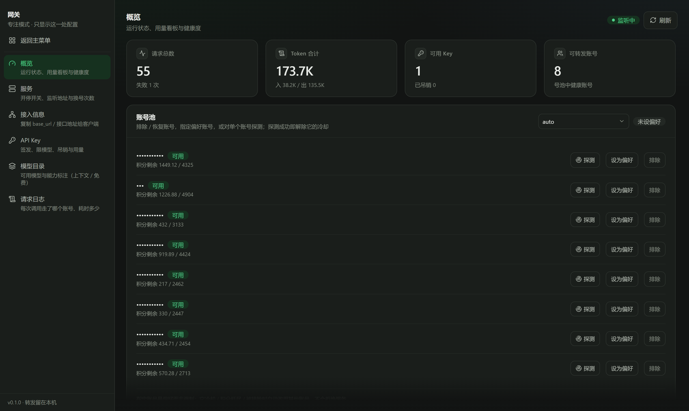

<h1 align="center">chaierww</h1>

<p align="center">
  <b>换一次号，从 60 秒到 1 秒。</b><br>
  <sub>WorkBuddy / Trae 多账号本地切换工作台</sub>
</p>

<p align="center">
  
  
  
</p>

<p align="center">
  <a href="#装"><b>下载安装</b></a> ·
  <a href="#它长这样">界面</a> ·
  <a href="#和手动切号比">和手动比</a> ·
  <a href="#常见问题">常见问题</a>
</p>

<p align="center">
  
</p>

## 换一个号，你要花多久

|  | 你要做的事 | 时间 |
|:--|:--|:--|
| **手动** | 退出 · 扫码 · 等同步 · 找回会话 | 约 60 秒 |
| **chaierww** | 点一下 | **1 秒** |

一天换 5 次号，一年下来有 **30 小时** 花在登出重登上。

chaierww 把 WorkBuddy 国内版和 Trae 国内版的账号收进一处，扫码登录一次，
之后换号是一次点击。切换前强制备份，中途失败自动回滚——不会把登录态写坏。

**所有数据只放在你自己的机器上**：没有云端中转，没有账号托管，断网也能切号。

> 非官方第三方工具，与 WorkBuddy / Trae 及其权利人无隶属、授权或背书关系。
> 它会读写本机客户端的认证数据、按你的配置自动发起请求。使用前请读
> **[免责声明](docs/policies/DISCLAIMER.md)**。

## 装

Windows 10 / 11，不用敲任何命令：

1. 到 [Releases](https://github.com/Chaierss/chaierww/releases) 下 `chaierww-Setup.exe`
2. 双击安装——免管理员，装进当前用户目录
3. 打开后扫码加号，之后点一下就能切过去

> 安装包没有代码签名，Windows 首次运行会拦一次：点「更多信息 → 仍要运行」。
> 这是没有付费证书的成本，不是包有问题。

> macOS / Linux 能装能开，但切号不完整（凭据加密与客户端检测都是 Windows 实现）。

升级不用管：启动时自动检查，发现新版本弹窗问你，下载完下次退出自动装上。

## 它长这样

| 号池 · 账号、积分、凭据状态一屏看全 | 用量 · 请求 + 积分，按模型、按日趋势 |
| --- | --- |
|  |  |

| 活动 · 签到与成长任务逐账号检测 | 网关 · 额度以 OpenAI / Anthropic 兼容接口开放 |
| --- | --- |
|  |  |

| 备份 · 每日自动一份，按份数滚动保留 7 份 | 环境 · 本机路径、客户端状态与边界 |
| --- | --- |
|  |  |

> 截图里的账号名、ID、本机路径是截图时直接脱敏的，不是事后手动画的。

## 除了切号

- **账号状态一屏看全**：凭据是否可用、积分还剩多少、几天后到期
- **签到和成长任务**逐账号检测，能自动的一键跑完，手动的写明为什么
- **用量**按模型、按日归集，谁在烧额度一眼看出
- **额度能借出去**：以 OpenAI / Anthropic 兼容接口开放给本机其它 AI 工具，Key 可签发可吊销
- **切换可预演**：先告诉你这次会迁移哪些数据、改动哪些文件，零写入

## 和手动切号比

| | chaierww | 手动退出重登 |
| :-- | :-- | :-- |
| **切号动作** | 一次点击 | 退出 → 重新登录 → 扫码 → 等验证 |
| **失败处理** | 自动回滚到切换前 | 状态写坏了自己排查 |
| **动手前** | 只读预演，先看会改哪些文件 | 直接改，改坏了才知道 |
| **多号轮换** | 按状态挑号，额度不足直接换 | 手动记账 |
| **数据** | 本机 `~/.chaierww`，每日自动备份 | 本机，无备份 |

## 数据只在你机器上

- 凭据用 Windows DPAPI 按当前用户加密，密钥不落文件；日志里一律脱敏
- 所有数据在 `~/.chaierww`（可用 `CHAIERWW_HOME` 覆盖），整个目录拷走就是完整迁移
- 没有服务端。断网、拔网线，切号照样能用

## 常见问题

**切号后客户端没起来 / 秒退？**
先看「概览 → 客户端」里的安装状态。切号走的是与双击图标等价的系统调用，
如果仍失败，多半是路径不对或客户端正在更新——到「设置 → 环境」核对登录目录。

**备份会占很多磁盘吗？**
常驻备份固定 7 份，单份约 30 MB，稳态 200 MB 上下。切换前的临时备份在成功后立即删除。

**会封号吗？**
只在本机读写客户端已有的登录态，不伪造请求、不并发登录、不改动客户端程序。
但任何第三方工具都有风险，**风险由使用者自行承担**。

## 它不做什么

写在这里是为了划边界，不是免责声明：

| 不做 | 原因 |
|:--|:--|
| 云端中转、账号托管 | 会让工具变成服务 |
| 账号分享、租借、拼车 | 同上 |
| 代登录（收集你的密码） | 凭据责任过重，且没必要 |
| 修改客户端程序本体 | 只读写状态文件，不打补丁 |
| 上传任何数据到服务器 | 数据只落本机 |
| 绕过平台额度或风控 | 它帮你管自己的号，不帮你薅 |

## 开发

仓库是完整的：凭据加密、切换引擎、两个客户端适配器都在 `src/chaierww/` 里，
clone 下来直接能跑，没有需要另外申请的私有包。

```bash
git clone https://github.com/Chaierss/chaierww.git && cd chaierww
python -m venv .venv
.venv/Scripts/activate                # macOS / Linux: source .venv/bin/activate
pip install -e ".[dev]"

python -m chaierww.main               # http://127.0.0.1:57910/
pytest                                # 431 个用例
ruff check src tests
```

要做桌面安装包：前端在 `web/`（`npm ci && npm run build`），Electron 壳在
`desktop/`，构建方式见 [desktop/README.md](desktop/README.md)。

想接一个新平台，看 `adapters/base.py` 的 slot 设计——新增一个 adapter 就够，
不用改切换引擎。改动前请读 [CONTRIBUTING.md](CONTRIBUTING.md)。

## 许可

[PolyForm Noncommercial License 1.0.0](LICENSE)——非商业用途可自由使用、修改、分发；
商业使用需另行获得作者授权。

```
Required Notice: Copyright (c) 2026 NextAgentX (https://github.com/NextAgentX/qoder-trae-workbuddy-switch)
Required Notice: Copyright (c) 2026 Chaierss (https://github.com/Chaierss)
```

Trae 的凭据信封解析（`domain/trae_crypto.py`）与扫码登录（`domain/trae_oauth.py`）
起于对 [qoder-trae-workbuddy-switch](https://github.com/NextAgentX/qoder-trae-workbuddy-switch)
的协议研究——那是同许可的 Rust/Tauri 实现，本项目用 Python 重写。按 PolyForm 的
Notices 条款，上游的 Required Notice 一并保留在上面，不做移除。

---

如果它帮你省下了每天那几趟登出重登，[点个 star](https://github.com/Chaierss/chaierww/stargazers)
就行——这是我继续维护它的主要动力。有问题 [开 issue](https://github.com/Chaierss/chaierww/issues)，
想参与开发见 [CONTRIBUTING.md](CONTRIBUTING.md)。
