<h1 align="center">chaierww</h1>

<p align="center">
  <b>换一次号，从 60 秒到 1 秒。</b><br>
  <sub>WorkBuddy / Trae 多账号本地切换工作台</sub>
</p>

<p align="center">
  
  
  
  <a href="https://github.com/Chaierss/workbuddy-trae-assist/releases"></a>
</p>

<p align="center">
  <a href="docs/QUICKSTART.md"><b>3 分钟上手</b></a> ·
  <a href="docs/QUICKSTART.en.md">English quick start</a> ·
  <a href="#安装">下载安装</a> ·
  <a href="#界面">界面</a> ·
  <a href="#功能">功能</a> ·
  <a href="#常见问题">常见问题</a> ·
  <a href="#开发">开发</a>
</p>

<p align="center">
  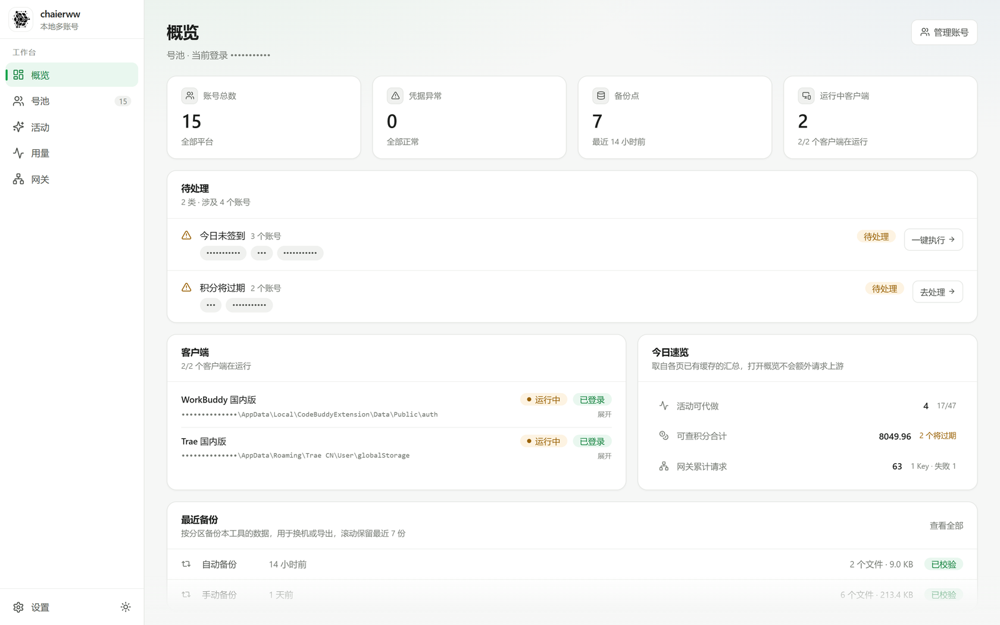
</p>

## 安装

到 [Releases](https://github.com/Chaierss/workbuddy-trae-assist/releases) 下载
`chaierww-Setup-<版本号>.exe`，双击安装。默认只为当前用户装、免管理员，装进当前用户目录；
向导会先展示许可要点与免责声明。打开后扫码加号，之后点一下就能切过去。

安装包没有代码签名，Windows 首次运行会拦一次：点「更多信息 → 仍要运行」。
这是没有付费证书的成本，不是包有问题。

**升级不用管。** 启动 8 秒后静默查一次更新源；有新版本只在托盘和「设置 → 常规」里提示，
不弹窗打断。点开才下载，下载完不打断你，下次退出应用时自动装上。
不想让它自动查，在「设置 → 常规」里关掉开关；手动检查也在那里。某个版本不想装，
可以在提示里点「跳过此版本」。

**平台：只有 Windows 10 / 11 (x64)。**

macOS / Linux 没有适配，也没有发布安装包。凭据加密用的是 Windows DPAPI，
客户端登录态也依赖 `APPDATA` / `LOCALAPPDATA` 定位，这两层目前只有 Windows 实现。
在 mac/Linux 上打包能成功，但后台进程一起来就报「后端服务已意外退出」——
发一个下了用不了的东西没有意义，所以构建矩阵里只保留了 Windows。

要补的话缺两块：`infra/secrets.py` 的跨平台加密（macOS 可用 Keychain，
Linux 可用 Secret Service 或 libsodium），以及 `adapters/` 里的目录定位。
Electron 外壳、托盘、构建脚本都是跨平台的，不用重写。欢迎 PR，切入点在[开发](#开发)一节。

## 它解决什么

一天换 5 次号，一年有 30 小时花在登出重登上。

|  | 手动 | chaierww |
|:--|:--|:--|
| 切号动作 | 退出 → 扫码 → 等同步 → 找回会话，约 60 秒 | 点一下，**1 秒** |
| 失败处理 | 状态写坏了自己排查 | 自动回滚到切换前快照 |
| 动手之前 | 直接改，坏了才知道 | 只读预演，先看会动哪些文件 |
| 多号轮换 | 手动记谁的积分先到期 | 按到期时间自动挑号 |
| 备份 | 没有 | 每日自动一份，滚动保留 7 份 |

它把 WorkBuddy 国内版和 Trae 国内版的账号收进一处，切换前强制备份、中途失败自动回滚，
不会把登录态写坏。**所有数据只在你自己的机器上**：没有云端中转，没有账号托管，断网也能切号。

> 非官方第三方工具，与 WorkBuddy / Trae 及其权利人无隶属、授权或背书关系。
> 它会读写本机客户端的认证数据、按你的配置自动发起请求。使用前请读
> **[免责声明](docs/policies/DISCLAIMER.md)**。

## 界面

| 号池 · 账号、积分、凭据状态一屏看全 | 用量 · 请求 + 积分，按模型、按日趋势 |
| --- | --- |
| 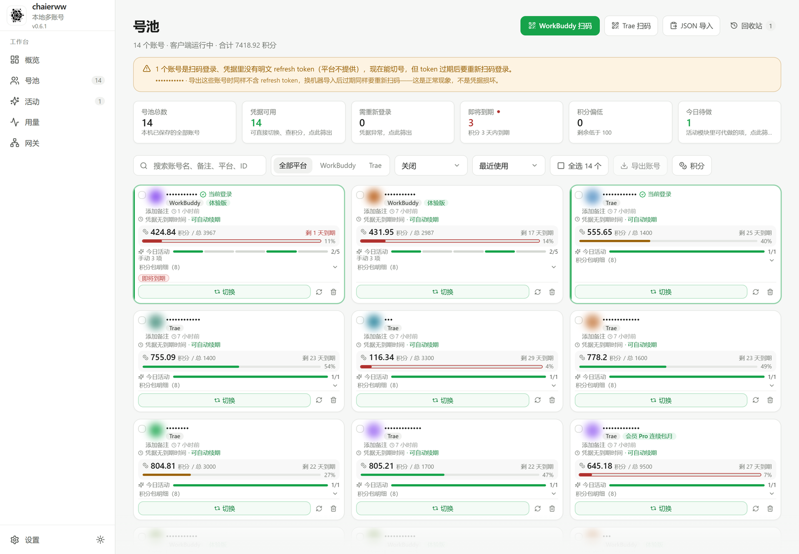 | 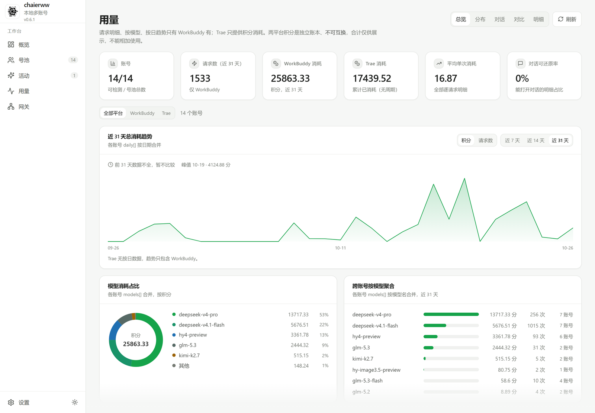 |

| 活动目录 · 平台有哪些活动、规则与奖励 | 按账号 · 每个号做到哪一步、还差什么 |
| --- | --- |
| 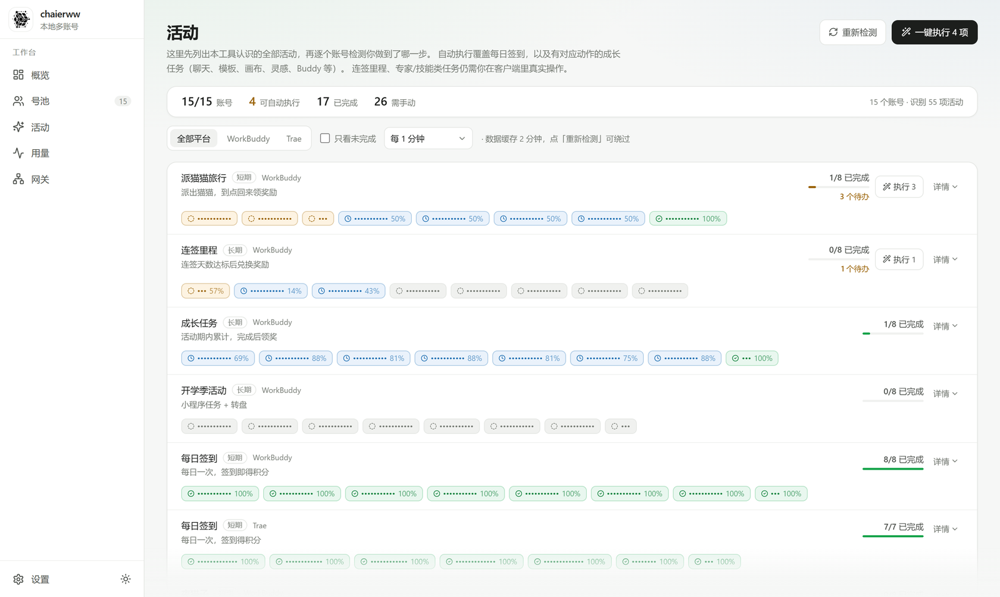 | 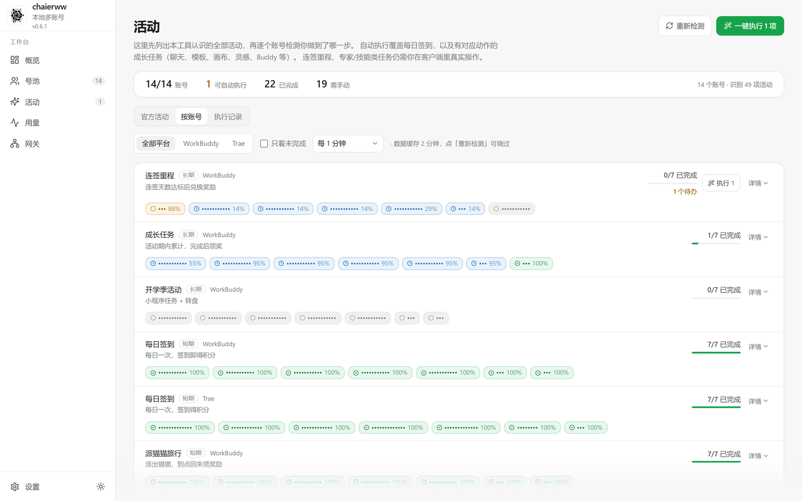 |

| 网关 · 额度以 OpenAI / Anthropic 兼容接口开放 | 模型目录 · 可用模型与能力标注 |
| --- | --- |
| 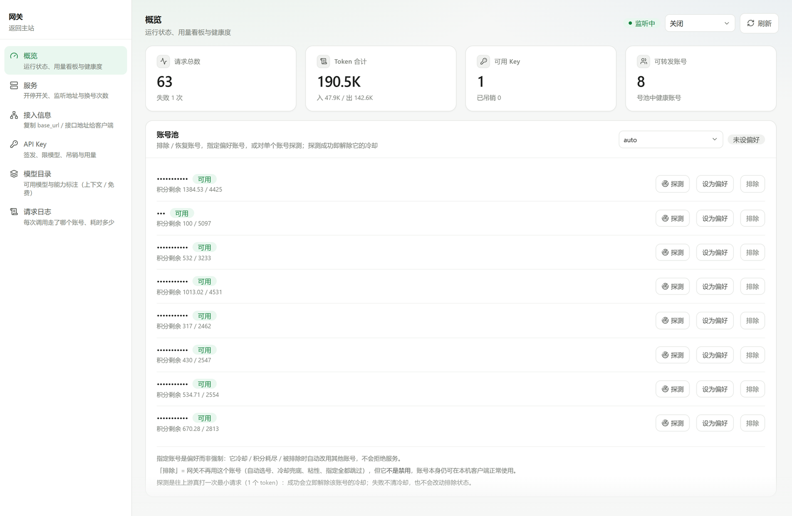 | 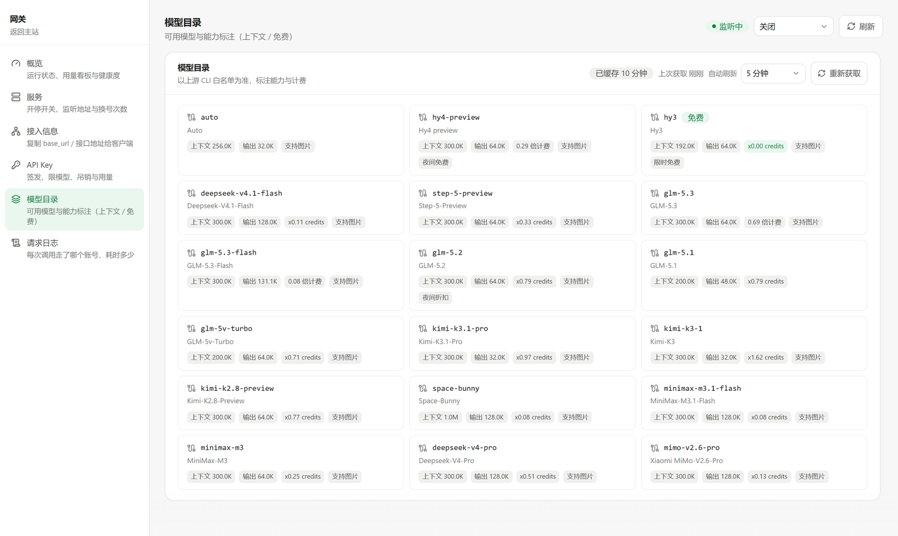 |

| 网关 Key · 签发、限模型、限额度、随时吊销 | 计划任务 · 一天多个时点，每档只留最近 7 次执行记录 |
| --- | --- |
| 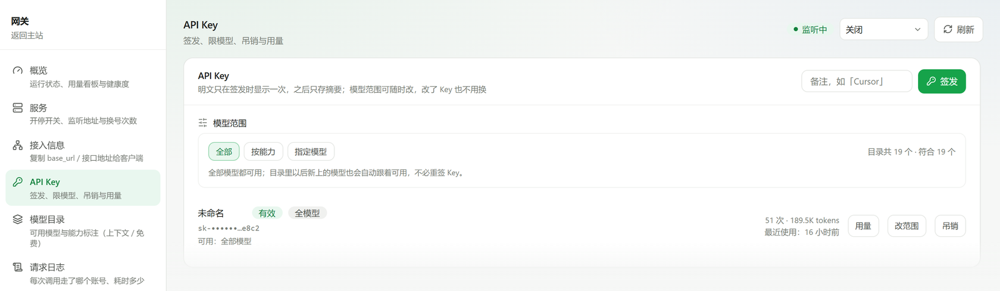 | 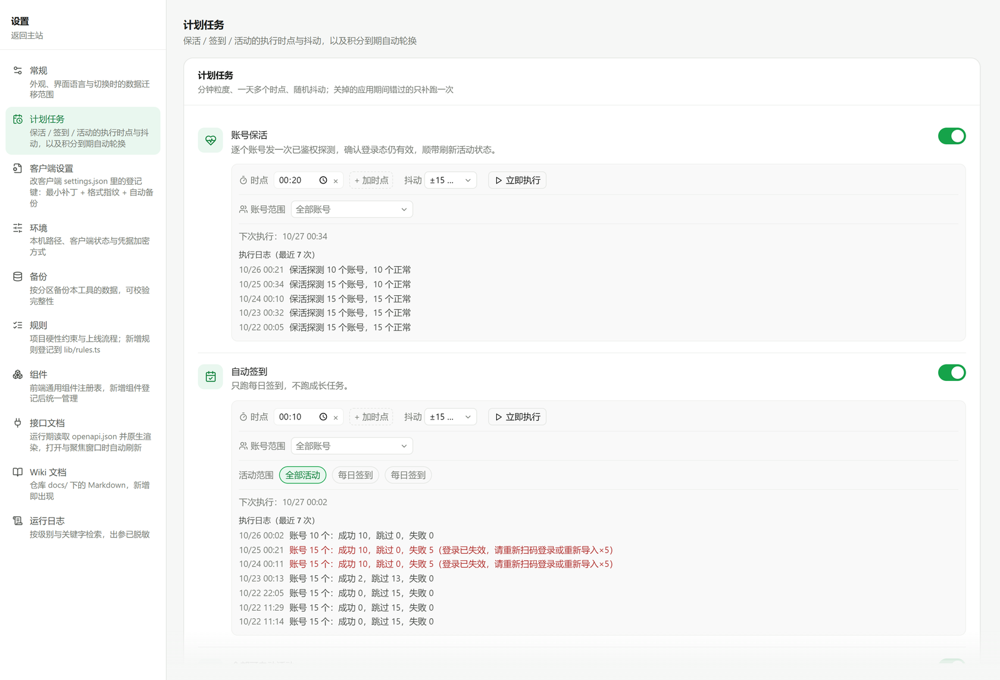 |

| 备份 · 每日自动一份，可校验、可回到任意一份 | 环境 · 本机路径、客户端状态与诊断包 |
| --- | --- |
| 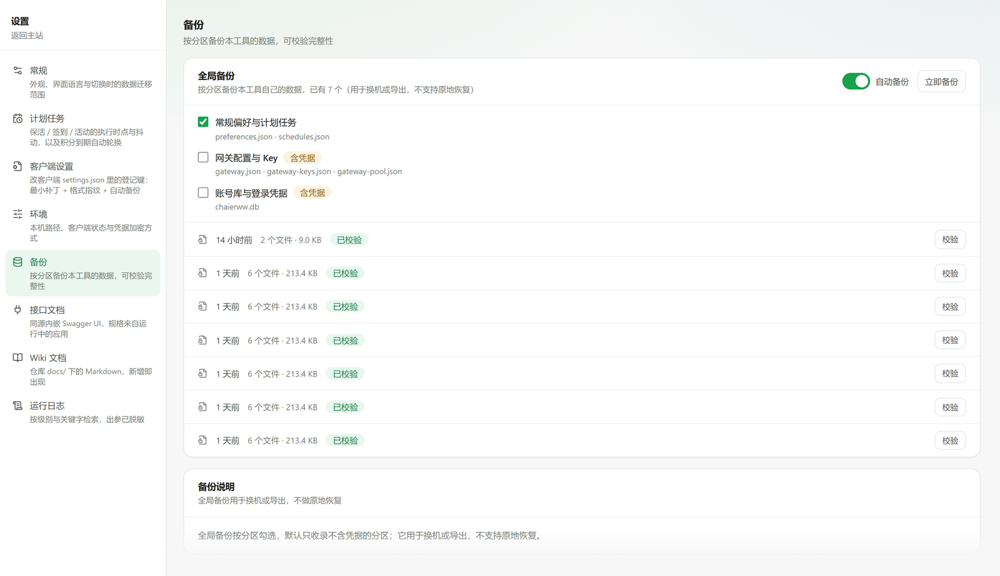 | 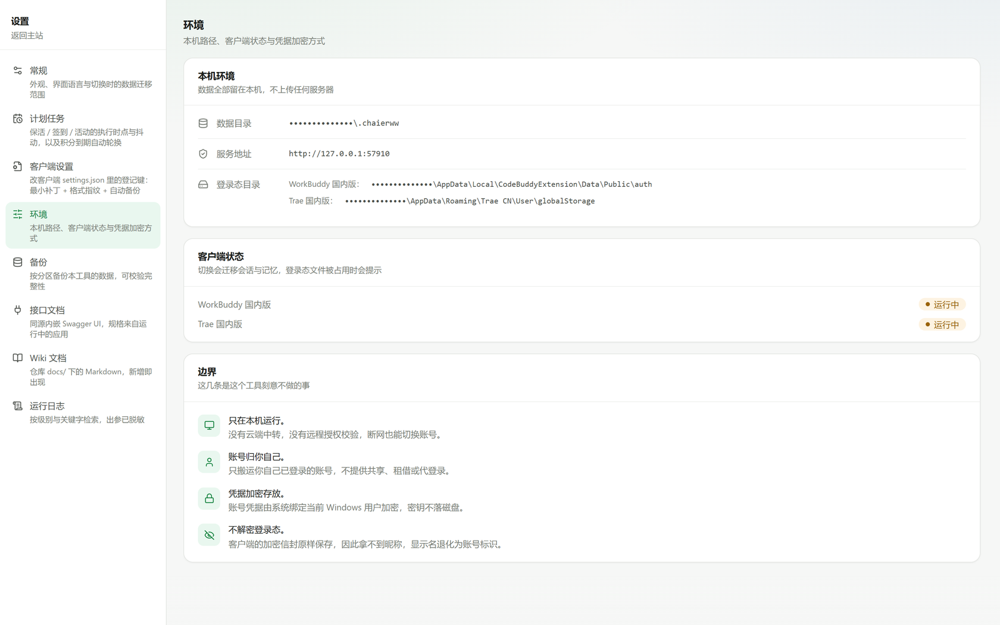 |

| 常规 · 换号时迁移哪几类数据，逐项可控 |
| --- |
| 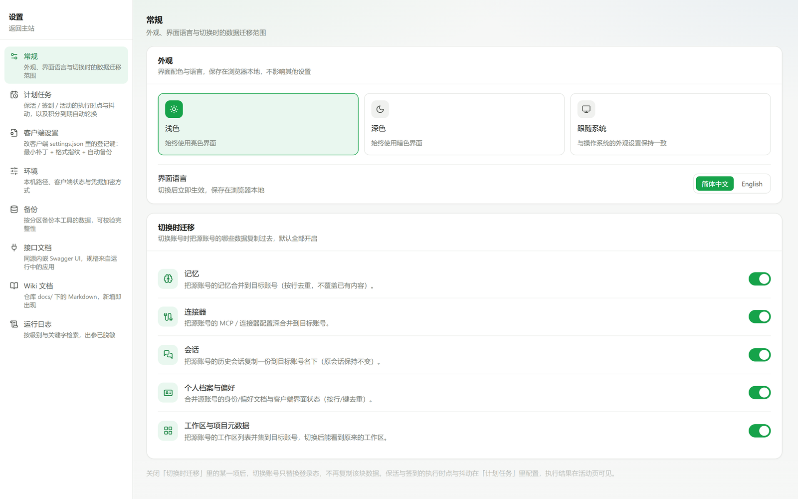 |

| 执行记录 · 每次跑活动都留结论与原因 |
| --- |
| 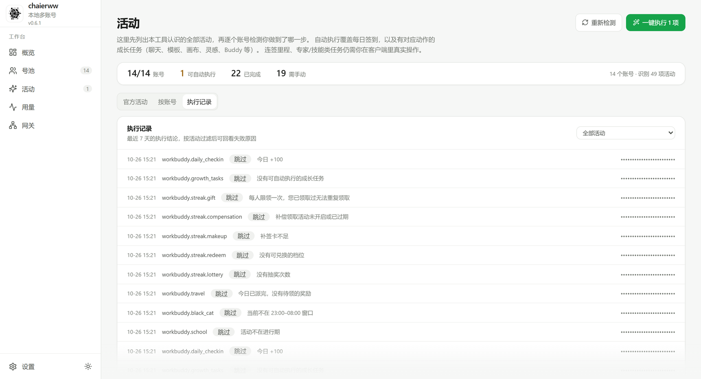 |

> 截图是脚本渲染完 DOM 再截的：账号名、账号 ID、邮箱、本机路径、网关 Key、IP
> 在快门按下之前就已经在页面里被替换成圆点或模糊，不是事后按坐标手画的，
> 所以界面改版也不用重新量坐标。生成方式是 `python scripts/shots.py`。

## 功能

- **账号状态一屏看全**：凭据是否可用、积分还剩多少、几天后到期
- **凭据会自己续**：扫码凭据在到期前 30 分钟内自动刷新（默认开启）；客户端信封凭据续不了时如实标注，并给重新登录入口
- **删错了能捞回来**：删除先进回收站保留 30 天，可恢复，也可提前彻底删除或一键清空
- **官方活动目录**：签到、成长任务、连签里程、派猫猫旅行、夜猫子、开学季逐条写清规则与奖励，
  目录随版本发布并在启动时校验；目录外的活动标「未收录」沉底，不会静默消失
- **按账号看进度**：同一个活动，每个号做到第几步、卡在哪一项、哪几项可自动跑，一屏说清
- **执行记录与趋势**：每次执行留结论与原因，详情里给 14 天成功 / 跳过 / 失败柱状趋势
- **用量**按模型、按日归集，谁在烧额度一眼看出
- **额度能借出去**：以 OpenAI / Anthropic 兼容接口开放给本机其它 AI 工具，Key 可签发可吊销，可按 Key 配每日 Token / 请求数与每分钟上限
- **计划任务**支持一天多个时点与随机抖动，每个任务可限定账号范围与活动范围，每档只留最近 7 次执行记录，成功失败都带原因
- **备份能回到过去**：快照可校验，也能选定一份恢复；恢复在下次启动、数据库打开前应用，失败自动回滚
- **会话跟着号走**：同机不同账号之间镜像聊天会话与网页版登录态，切号后接着聊；
  正文按内容哈希只存一份，源端续写只追加、删除会跟随，冲突保留本地并可逐条处理。
  Trae 等没有本地会话库的平台会明确标注「不支持」，不跨设备
- **出问题能自救**：设置 → 环境给出健康度面板与「导出诊断包」，只含版本、计数与脱敏日志
- **新装不迷路**：首启给一份四步清单（装客户端 → 扫码加号 → 第一次换号 → 留下），
  可跳过、可折叠；装过号的老用户自动视为已完成，不会被打扰
- **本地体验数据**：首次成功换号率、TTFV 这类匿名计数只写本机，可在「设置 → 环境 → 体验数据」关闭、导出与清空
  （[说明](docs/policies/TELEMETRY.md)），不上云、可一键删除

## 数据与安全

- 凭据用 Windows DPAPI 按当前用户加密，密钥不落文件；日志里一律脱敏
- 本机接口默认带同源守卫：浏览器同源 Cookie 放行，外部脚本用 `~/.chaierww/api-token`；
  非回环 `Host` / `Origin` 一律拒绝（[细节](docs/README.md)）
- 配置与数据库写入走原子写：临时文件 + fsync + 替换，损坏的 JSON 隔离留证，不静默覆盖
- 所有数据在 `~/.chaierww`（可用 `CHAIERWW_HOME` 覆盖），整个目录拷走就是完整迁移
- 没有服务端。断网、拔网线，切号照样能用

细节和威胁模型见 **[SECURITY.md](SECURITY.md)**。

下面这些是刻意的架构决定，不是还没做：

| 不做 | 原因 |
|:--|:--|
| 云端中转、账号托管、账号分享 | 会让工具变成服务 |
| 代登录（收集你的密码） | 凭据责任过重，且没必要 |
| 修改客户端程序本体 | 只读写状态文件，不打补丁 |
| 上传任何数据到服务器 | 数据只落本机：统计也只有本机匿名计数，不上传、不接第三方 SDK |
| 绕过平台额度或风控 | 它帮你管自己的号，不帮你薅 |

## 常见问题

**切号后客户端没起来 / 秒退？**
先看「概览 → 客户端」里的安装状态。切号走的是与双击图标等价的系统调用，
如果仍失败，多半是路径不对或客户端正在更新——到「设置 → 环境」核对登录目录。

**会封号吗？**
签到是代你调一次平台自己的接口，请求头和参数照客户端的行为构造，不并发登录、不改动客户端程序。
但**成长任务不一样**：其中有 10 项是通过接口把任务标记为完成，并不是在你的客户端里真的做了那个动作——
这条链路性质更弱，所以计划任务默认不包含它，手动执行前也会弹一次说明。
任何第三方工具都有风险，**风险由使用者自行承担**。

**备份会占很多磁盘吗？**
常驻备份固定 7 份，单份约 30 MB，稳态 200 MB 上下。切换前的临时备份在成功后立即删除。

**会用我的数据做统计吗？**
会，但只在本机。工具记的是 7 个匿名事件（打开应用、检测到客户端、完成引导某一步、加号、预演、换号成功、签发网关 Key），
属性只有语言、平台、步骤这类枚举值；不记账号名、账号 ID、凭据、对话正文与路径。
数据写在 `~/.chaierww/metrics/events.ndjson`，不上传，可在「设置 → 环境 → 体验数据」一键关闭、导出或清空。
详见 **[本地体验数据说明](docs/policies/TELEMETRY.md)**。

**升级会丢数据吗？**
不会。`~/.chaierww` 和安装目录是分开的，覆盖安装不碰数据；每日自动备份也照常在跑。

## 开发

仓库是完整的：凭据加密、切换引擎、两个客户端适配器都在 `src/chaierww/` 里，
clone 下来直接能跑，没有需要另外申请的私有包。

```bash
git clone https://github.com/Chaierss/workbuddy-trae-assist.git
cd workbuddy-trae-assist
python -m venv .venv
.venv/Scripts/activate                # macOS / Linux: source .venv/bin/activate
pip install -e ".[dev]"

python -m chaierww.main               # http://127.0.0.1:57910/
pytest                                # 682 个用例
ruff check src tests
```

桌面安装包：前端在 `web/`（`npm ci && npm run build`），Electron 壳在 `desktop/`，
构建方式见 [desktop/README.md](desktop/README.md)。

```
src/chaierww/
  adapters/    读客户端登录态：workbuddy.py / trae.py，slot 抽象在 base.py
  domain/      切换引擎、活动签到、积分、额度网关、计划任务、自动轮换
  infra/       凭据加密（secrets.py）、SQLite、父进程守护
  api/         本地 HTTP 接口，桌面端与前端共用
web/           Vue 3 + TypeScript + Tailwind 前端
desktop/       Electron 壳、托盘、自动更新、PyInstaller 打包
scripts/       构建、截图脱敏、诊断脚本
tests/         pytest 用例（635 个）
```

想接一个新客户端，看 `adapters/base.py` 的 slot 设计——新增一个 adapter 就够，
不用改切换引擎。想补 macOS / Linux，从 `infra/secrets.py` 和两个 adapter 的
`default_paths()` 入手，补完在 `build-desktop.yml` 的矩阵里加回对应 runner 即可。

### 文档

| 文档 | 讲什么 |
| :-- | :-- |
| [docs/QUICKSTART.md](docs/QUICKSTART.md) | 3 分钟上手：安装、加号、预演、切换、常见失败 |
| [docs/QUICKSTART.en.md](docs/QUICKSTART.en.md) | English quick start |
| [CONTRIBUTING.md](CONTRIBUTING.md) | 开发约定、提交规范、测试方式 |
| [SECURITY.md](SECURITY.md) | 安全模型、漏洞报告渠道 |
| [CHANGELOG.md](CHANGELOG.md) | 每个版本改了什么 |
| [desktop/README.md](desktop/README.md) | 打包、自动更新、安装包排障 |
| [docs/policies/DISCLAIMER.md](docs/policies/DISCLAIMER.md) | 免责声明（使用前请读） |
| [docs/policies/TELEMETRY.md](docs/policies/TELEMETRY.md) | 本地体验数据：记什么、存哪、怎么关 |

## 许可

[PolyForm Noncommercial License 1.0.0](LICENSE)。

**源码全部公开，但这不是一个 OSI 认可的开源许可。** 准确说法是 source-available：

- ✅ 个人使用、学习、修改、二次分发（非商业目的）
- ❌ 任何商业用途——包括公司内部使用、打包进商业产品、对外提供付费服务
- 商业使用需另行获得作者授权（[开 issue](https://github.com/Chaierss/workbuddy-trae-assist/issues) 联系）

```
Required Notice: Copyright (c) 2026 NextAgentX (https://github.com/NextAgentX/qoder-trae-workbuddy-switch)
Required Notice: Copyright (c) 2026 Chaierss (https://github.com/Chaierss)
```

第一行属于上游：Trae 的凭据信封解析（`domain/trae_crypto.py`）与扫码登录
（`domain/trae_oauth.py`）起于对
[qoder-trae-workbuddy-switch](https://github.com/NextAgentX/qoder-trae-workbuddy-switch)
的协议研究——那是同许可的 Rust/Tauri 实现，本项目用 Python 重写。
按 PolyForm 的 Notices 条款，上游的 Required Notice 必须一并保留，不做移除。

---

如果它帮你省下了每天那几趟登出重登，[点个 star](https://github.com/Chaierss/workbuddy-trae-assist/stargazers)
就行。有问题[开 issue](https://github.com/Chaierss/workbuddy-trae-assist/issues)，
想参与开发见 [CONTRIBUTING.md](CONTRIBUTING.md)。
